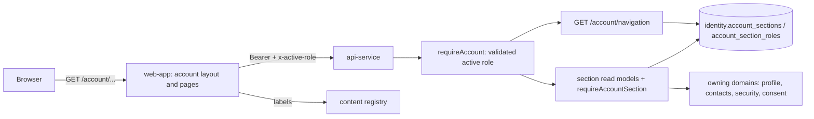

# Shared Account Area

The account area (ACC-001) is the one place where a signed-in person manages their account: profile, contact details, security, language and region, privacy and data, roles. It is ONE framework for every persona. What differs between a customer, a provider and (later) a business owner or staff member is the set of sections in their menu, which is data selected by the role they are acting as, not a separate account system. Decision: ADR-0039. The account, roles and the active role are ADR-0025 and ADR-0026 (`docs/engineering/ACCOUNTS.md`); the domains the sections compose are `EMAIL_VERIFICATION.md`, `PHONE_VERIFICATION.md`, `SESSIONS_AND_MFA.md` and `CONSENT.md`.

Requirements served: SV-11 (the shared account requirements: names, roles section, language and region, privacy and data, closing the account as a placeholder), CU-09, PR-09, PB-03 and AD-07 (the persona account areas are the shared sections plus role-specific ones that later checkpoints add), CU-03.03 (role switch without signing in again). The account area stores no personal data of its own.

## Scope

In scope: the section registry (two reference tables), the role-driven navigation, the guarded section read models (profile, contact details, security summary, privacy summary, roles), the partial profile update, the server-side section guard, and the responsive, accessible web shell with one page per section.

Not in scope (see `TECH_DEBT.md`, DEBT-0082): the final visual design, notification preferences, saved addresses, payment methods, provider public profile and business details, payout and tax, plan and billing, closing or deleting the account, the privacy export, an admin console for the registry, per-person section preferences, and any section whose capability does not exist.

## Architecture

| Layer | File | Responsibility |
|---|---|---|
| Database | `db/migrations/0014_account_area.sql` | `account_sections`, `account_section_roles`, the guard triggers, the seeds (8 sections, 16 matrix rows, 64 copy entries) |
| Contracts | `packages/contracts/src/account-area.ts` | the section vocabulary, the navigation and section DTOs, `PatchProfileRequest`, `PROFILE_FIELD_SECTIONS`, `ACCOUNT_AREA_COPY` |
| Registry service | `packages/accounts/src/account-area.ts` | `AccountAreaService.sectionsOf`, `navigation`, `assertSection`; `FakeAccountArea` |
| Profile | `packages/accounts/src/service.ts` | `patchProfile` (and `upsertProfile`) over a shared `applyProfile` |
| Security summary | `packages/accounts/src/security-service.ts` | `getSummary` |
| Section guard | `apps/api/src/plugins/account-section.ts` | `requireAccountSection`, `requireAnyAccountSection`, `assertAccountSections` (one registry read per request) |
| API routes | `apps/api/src/modules/account/area-routes.ts`, `routes.ts` | the operations below (seven new, `PUT /account/profile` guarded) |
| Web | `apps/web/src/app/account/**`, `apps/web/src/app/auth/account/**`, `apps/web/src/lib/**` | the shell, the pages and the form handlers |

`@bananagig/accounts` stays API-only; the web calls the API and imports contracts only (`pnpm deps:check`).

## The section registry

`identity.account_sections` (what the area can contain) and `identity.account_section_roles` (which role sees which section, in which order):

| Section | Page | Status | CUSTOMER | PROVIDER | Backing capability |
|---|---|---|---|---|---|
| `PROFILE` (10) | `/account/profile` | ACTIVE | yes | yes | `identity.account_profiles` (ID-001) |
| `CONTACT_VERIFICATION` (20) | `/account/contact` | ACTIVE | yes | yes | ID-002, ID-003 (masked states) |
| `SECURITY` (30) | `/account/security` | ACTIVE | yes | yes | ID-004 (links to `/security`) |
| `LANGUAGE_REGION` (40) | `/account/language-region` | ACTIVE | yes | yes | preferred locale, time zone (ID-001, GEO-001) |
| `PRIVACY_DATA` (50) | `/account/privacy` | ACTIVE | yes | yes | ID-005 (links to `/consents`) |
| `ROLES` (60) | `/account/roles` | ACTIVE | yes | yes | ID-001 (role switch) |
| `NOTIFICATIONS` (70) | `/account/notifications` | PLANNED | off | off | NOTIF-001 |
| `CLOSE_ACCOUNT` (80) | `/account/close` | PLANNED | off | off | closure rules (DEBT-0045) |

CUSTOMER and PROVIDER see the same six sections today because no role-specific capability exists yet. The matrix is per role so that a role-specific section is one more row when its checkpoint ships. The role-driven difference is proven by tests that add rows to an isolated database; the seeded data does not show it, and the documentation says so rather than inventing sections.

- Labels and descriptions are content keys (`account.area.section.<code>.label|description`); the page copy is `ACCOUNT_AREA_COPY`. Nothing visible is hardcoded.
- **Availability** has one definition: an `enabled` matrix row of an `ACTIVE` role for an `ACTIVE` section. The guard triggers enforce it in both directions (enabling needs an ACTIVE section and role: `SECTION_NOT_ACTIVE`, `ROLE_NOT_ACTIVE`; neither can leave ACTIVE while a row is enabled: `SECTION_IN_USE`, `ROLE_HAS_SECTIONS`; immutable keys, no DELETE or TRUNCATE) and the read query repeats it. Swapping the display orders of two rows takes three statements (the unique key is not deferrable).
- No effective dates: a section becomes available when its capability ships, in the same release as its migration. No per-person preference exists.

## API

All under `/api/v1`, Bearer, standard envelope, `Cache-Control: no-store`, strict queries and bodies, no account id, role or section list from the client.

| Operation | Method and path | Guard | Returns |
|---|---|---|---|
| `getAccountNavigation` | GET `/account/navigation` | the account guard | `activeRole`, `roles` (the role switcher), `sections` (code, page, label and description keys, in menu order), `contacts` (derived verified flags) |
| `getAccountProfile` | GET `/account/profile` | PROFILE or LANGUAGE_REGION | the profile with the derived `displayName`, or `null` |
| `patchAccountProfile` | PATCH `/account/profile` | per field: names need PROFILE, locale and time zone need LANGUAGE_REGION | `{ changed, profile }` |
| `updateAccountProfile` | PUT `/account/profile` (ID-001, unchanged) | PROFILE and LANGUAGE_REGION | the account (full replace) |
| `getAccountContactVerification` | GET `/account/contact-verification` | CONTACT_VERIFICATION | the masked email and phone states and the derived summary (the same values as `/account/me`) |
| `getAccountRolesSection` | GET `/account/roles` | ROLES | held roles, active role, preferred role, `switchableTo` |
| `getAccountSecuritySummary` | GET `/account/security-summary` | SECURITY (security layer wired) | `mfa.available`, `mfa.enabled`, `activeSessionCount`, `currentBrowserTrusted` |
| `getAccountPrivacySummary` | GET `/account/privacy` | PRIVACY_DATA (consent layer wired) | `consents.locale`, `satisfied`, `outstandingCount`, `dataDownload.available` (false) |

Role switching is the existing `POST /account/active-role` (validation only) behind the BFF route `POST /auth/active-role`; nothing here grants a role. Errors follow the account error model; the new code is `ACCOUNT_SECTION_NOT_FOUND` (404).

### Section authorization (404, not 403)

A section the ACTIVE role of the request does not have is answered `404 ACCOUNT_SECTION_NOT_FOUND`, identical for an unknown, planned, retired and not-enabled section, and without naming the section or the role. 403 would confirm the section exists for another persona. The order of checks is: 401 (token, revoked session), 403 (admin context, suspended or closed account, role not held or not active), then 404 (section) for the routes whose sections are static (the reads and `PUT /account/profile`: a body is never evaluated for a section the role lacks); `PATCH /account/profile` derives its sections from the fields present, so its strict body (400) is checked before its sections (404). The guard reads the role's sections ONCE per request. An account with no usable active role (no role, or several and none chosen) has no sections: every guarded route is a 404 and the navigation lists none (the client must choose a role first, `POST /account/active-role`). Domain endpoints (email, phone, security, consent) are NOT gated by sections, so a sign-up or onboarding flow keeps working whatever the menu contains.

## Composition, not duplication

- **Profile**: the section edits `identity.account_profiles` through `AccountService` (names, preferred locale, time zone override). `PATCH` changes only the present fields (absent keeps, `null` clears the optional two), reads the stored row `FOR UPDATE` in the transaction (two concurrent edits of different fields both apply), validates exactly as `PUT` (names normalized and checked, the locale an ACTIVE `content.locales` row, the zone an ACTIVE registered zone, never free text) and writes the `PROFILE_UPDATED` audit row with the changed field NAMES. A profile that does not exist yet needs both names.
- **Contact details**: the masked states and the derived summary the account guard already read. Nothing is stored or recomputed.
- **Security**: the second-factor flag from the identity provider (`available` is false when it cannot be asked), a count of registered live sessions (the window of the session list, NOT reconciled with the identity provider) and the trust of this browser. The security centre (`/security`) stays the place to act.
- **Privacy and data**: counts evaluated by the consent service for the account's roles and locale (no document, version, hash or history), and the data-download contract (`available: false` until the export exists).
- **Roles**: the held roles and the switch targets.

## Performance

The navigation costs the account guard's reads plus ONE registry read (`sectionsOf`: roles, the role's enabled matrix rows in menu order through `uq_account_section_roles__role_order`, and the ACTIVE sections), whatever the number of sections. A section read model costs the guard's reads plus the same single registry read plus its own domain read. There is no per-section request and no cache: the registry is a tiny table read through a unique key, and a cache would need an invalidation design (DEBT-0082). The web layout fetches the session, the navigation and the content ONCE per request (React `cache()` shared by layout, page and metadata): every label and sentence of the page is resolved in one batch, except the three sentences with required variables (the current role, the role to switch to, the count of agreements), which are resolved individually with their values because the batch resolver fails as a whole when a variable is missing.

## Web

Every section has its own URL: `/account` (home), `/account/profile`, `/account/contact`, `/account/security`, `/account/language-region`, `/account/privacy`, `/account/roles`. A registry section without a page (today Notifications and Close account, and any future one) and a section the API answers 404 for end in the standard not-found page; the server decides, the menu does not. Forms are plain no-JavaScript POSTs to same-origin BFF routes (`POST /auth/account/profile`, `POST /auth/account/language-region`, `POST /auth/active-role`) that check the `Origin`, require the session, allowlist the form fields, call the API with the session token and answer 303 with a flag (`?saved=1`, `?unchanged=1`, `?error=...`).

With the root `loading.tsx` present Next streams every dynamic page, so a not-found section is HTTP 200 carrying the not-found content (and a noindex tag) and not a 404; the authoritative 404 is the API's `ACCOUNT_SECTION_NOT_FOUND` (LRN-0053).

The shell is responsive and mobile first: on a phone the home page is the menu and a section page shows the back link and the content in one column; from the tablet width the menu is a sidebar beside the content. Accessibility: a skip link, a `nav` landmark named from the managed copy, `aria-current="page"` on the current section, one `h1` per page (the section label), labelled form fields, notices and errors in live regions, touch targets of at least 44 by 44 CSS pixels, a visible focus outline, and no control that works on hover only.

## Privacy and security

- The account area returns the caller's own data only, from the account of the VERIFIED token; no route accepts an account id, a subject, a role or a section list.
- No email address, phone number, session id, token or legal-history detail is in the navigation. The contact section returns the MASKED values the account already exposes; the privacy section returns counts.
- The area adds no audit row or event of its own: reading a section is not audited, and the only mutation is the profile, audited by the service by field name (never value); no event is emitted because no consumer exists (DEBT-0082). One read is not side-effect free by construction: `GET /account/security-summary` goes through the security overview of ID-004, which asks the identity provider on every call and, when it observes a new second-factor or password transition, writes the audit rows, outbox events and revocations that overview always writes.
- Every response, errors included, is `Cache-Control: no-store`; the web pages are rendered per request.
- Hidden means absent on the server (404), and the web shell shows exactly what the API returned.
- Section gating decides what the ACCOUNT AREA offers; it is NOT a read-confidentiality control. `GET /account/me` and the domain endpoints are not gated by sections and return the caller's own names, locale, time zone and masked contacts to any role, `GET /account/profile` returns all four profile fields to a role that has only one of the two profile sections, and a `PATCH` answers with the full profile. All of it is the caller's own data; the WRITE side is field-gated because `/account/profile` is the only writer of `identity.account_profiles`.
- The Roles page is the only place the area offers to switch back, so ROLES must stay enabled for every role that can be switched to; the switch form returns to `/account` (which exists for every role) and not to the Roles page for that reason.

## Testing

Run the files rather than quoting counts: the contracts (`packages/contracts/src/account-area.test.ts`), the registry model (`packages/testing/src/account-area-model.itest.ts`: shape, seeds, every guard, the lock race), the services (`packages/accounts/src/account-area.test.ts`, `account-area.itest.ts`, `profile-patch.itest.ts`, `security-summary.itest.ts`), the API (`apps/api/src/account-area.test.ts`, `account-area.itest.ts`: role-driven sets, enforcement of a disabled row, the query budget with 8 and with 48 sections) and the web (`apps/web/src/account-area*.test.tsx`). The smoke scenario `Account area` drives the flow end to end. Commands: `pnpm --filter <package> test`, one integration file with `node --env-file-if-exists=.env.host node_modules/vitest/vitest.mjs run -c vitest.integration.config.ts <file>`, `pnpm smoke`.

## How to add a section

1. Add the section's managed copy (label, description, page copy) through the content lifecycle in a forward migration (copy the seed pattern of `0014_account_area.sql`).
2. In the same migration insert the `account_sections` row (`PLANNED` until the page exists, then `ACTIVE`) and the matrix rows for the roles that see it, with a display order that fits between two others.
3. Add its code to `ACCOUNT_SECTIONS` and its copy keys to `ACCOUNT_AREA_COPY` (contracts), a guarded endpoint behind `requireAccountSection(code)` that composes the owning domain, and a web page; keep the web page and the migration in the same release.
4. Add tests: the guard (the section enabled, disabled, not in the role's set), the composition, the page, the registry shape. Update `DATA_MODEL.md` and the other data documents (the seed is part of the model).

## Troubleshooting

| Symptom | Likely cause |
|---|---|
| a section page is the not-found page for a signed-in person | the active role has no enabled row for the section (check the matrix for that role), the section is `PLANNED` or `INACTIVE`, or the account has no usable active role (several roles and none chosen: `POST /account/active-role` first) |
| 404 `ACCOUNT_SECTION_NOT_FOUND` on a section the menu shows | the menu and the guard read the same registry, so the role changed between the two requests (the web session remembers a role the API now refuses) |
| the menu is empty | no active role, or every row of the role is disabled |
| 503 `ACCOUNT_UNAVAILABLE` on the navigation | PostgreSQL could not answer, or a registry row violates the route format (`REGISTRY_INVALID`) |
| the session count in the security section looks higher than the security centre | the summary is not reconciled with the identity provider (by design) |
