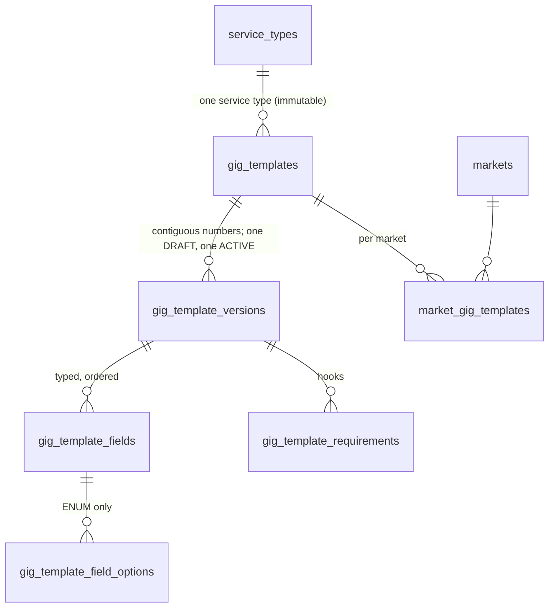

# Gig Templates

CAT-002. The PLATFORM-OWNED, versioned structure a provider builds a Gig from. Decision record: `docs/architecture/ADR-0041-versioned-platform-gig-templates-referenced-immutably-by-provider-gigs.md`. The taxonomy above it is in `docs/engineering/CATALOG.md`.

## Ownership

| Object | Owner | Where |
|---|---|---|
| Category, Service Type | Platform | `catalog.categories`, `catalog.service_types` (CAT-001) |
| **Gig Template** (identity) | Platform | `catalog.gig_templates` |
| **Gig Template version** (frozen structure) | Platform | `catalog.gig_template_versions` and its child tables |
| Gig (price, floor price, chosen duration, radius or area, pitch, photos, capacity, variants, add-ons, booking mode) | Provider | CAT-003 and later; **nothing of it exists here** |

A template says "a Full Detail Gig must state its inclusions (fixed by the platform), choose a finish, show at least two photos, and last between 60 and 240 minutes". A Gig says "my Full Detail costs ... and covers radius ...". The Gig will store the exact `gig_template_version_id` it was built from; that version can never change.

## Model

- **Identity** (`gig_templates`): immutable `code` and service type, name / description / instructions content keys derived from the code, status `DRAFT -> ACTIVE <-> INACTIVE -> RETIRED` (the catalogue machine). Never deleted.
- **Version** (`gig_template_versions`): `DRAFT -> ACTIVE (publish) | RETIRED (discard)`, `ACTIVE -> SUPERSEDED (automatic) | RETIRED (done by the retirement of the template; the API offers no direct withdraw of an ACTIVE version, pause or retire the template instead)`. Duration guidance (min, max, suggested minutes; all optional), pricing flags (`FIXED`, `FIXED_WITH_VARIANTS`, `BUNDLE_ELIGIBLE`, `DROP_ELIGIBLE`; at least one base model), area flags (`RADIUS`, `POSTAL_CODES`, `POLYGON`; at least one), `revision` (draft token), `published_at`, `closed_at`.
- **Fields**: type (`TEXT`, `LONG_TEXT`, `INTEGER`, `DECIMAL`, `BOOLEAN`, `ENUM`, `DURATION`, `MONEY`, `MEDIA`, `EQUIPMENT_REFERENCE`, `SKILL_REFERENCE`), behaviour (`PLATFORM_FIXED`, `PROVIDER_CONFIGURABLE`, `PROVIDER_REQUIRED`), section (`SCOPE`, `INCLUSIONS`, `EXCLUSIONS`, `PREPARATION`, `DETAILS`), customer visibility, order, typed metadata. Which metadata a type may carry:

| Type | Metadata |
|---|---|
| `TEXT`, `LONG_TEXT` | min / max length, default text (a content entry) |
| `INTEGER`, `DECIMAL` | min / max / default number (`INTEGER` whole) |
| `DURATION` | min / max / default minutes (whole, at least 1) |
| `BOOLEAN` | default |
| `ENUM` | options (code, label, one default) |
| `MEDIA` | min / max items; `max = 0` means no photos; required needs `min >= 1` |
| `EQUIPMENT_REFERENCE`, `SKILL_REFERENCE` | min / max selections |
| `MONEY` | none: amount limits are configuration (CFG-001) |

`PLATFORM_FIXED` is allowed only for types with a default (text, numbers, boolean, enum, duration) and then the default is mandatory. A photo rule is derived: required (`PROVIDER_REQUIRED`, `min >= 1`), prohibited (`max = 0`), otherwise optional.
- **Requirements**: hooks (`SKILL`, `EQUIPMENT`, `LICENSE`, `INSURANCE`, `BACKGROUND_CHECK`) with an optional opaque reference code that TRUST-001 will give a catalogue. Not validated now, no verification logic.
- **Availability** (`market_gig_templates`): enabled flag and order per market, unique order per market.

## Content

Every text is a CFG-002 entry with a key DERIVED from the template code and the field key and shared by all versions:

| Text | Key |
|---|---|
| name (required) | `catalog.gig_template.<code>.name` |
| description, instructions (optional) | `catalog.gig_template.<code>.description`, `.instructions` |
| field label (required), help, default text | `catalog.gig_template.<code>.field.<field_key>.label`, `.help`, `.default` |
| option label | `catalog.gig_template.<code>.field.<field_key>.option.<option_code>.label` |

The entries must EXIST before a draft names them (foreign keys; the API names the missing keys) and must be PUBLISHED before the version can be published: an ACTIVE entry with a version the content resolver would serve today (SCHEDULED, PUBLISHED or SUPERSEDED, platform scope, in force now) in the platform default locale (the API names the unpublished keys). Wording is not frozen per version: a text change reaches every version. A field whose meaning changes gets a new field key.

## Lifecycle

1. Create the template (DRAFT) under a service type; activate it (needs an ACTIVE service type).
2. `POST .../versions` creates the next draft (empty, or `copyFromVersion`). One draft at a time.
3. `PUT .../versions/:n` replaces the WHOLE draft (`expectedRevision` = the revision last read; a different one is `STALE_DRAFT`).
4. `POST .../versions/:n/publish` (`expectedRevision`): needs an ACTIVE template and service type, at least one field, enum options, published copy. The version becomes ACTIVE and frozen; the previous ACTIVE version becomes SUPERSEDED. Repeating it with the same revision changes nothing.
5. Enable the template in a market (`PUT /markets/:market/gig-templates/:code`); the market must be ACTIVE and in effect, and the service type public in it, for anything to be public.
6. Pause (`INACTIVE`) or retire (`RETIRED`, terminal) the template. Retiring discards an open draft and closes the ACTIVE version; every version stays readable. A discarded draft keeps its number.

A published version is never edited: the fix is a new version copied from it.

## API

Prefix `/api/v1/catalog`. Reads are shared by the public and the management view (`Vary: Authorization`); the public view needs `market` and a market that is ACTIVE and in effect (anything else is a 404, identical to an unknown market). Roles: the admin context plus `catalog-read` / `catalog-write` (DEBT-0021 model); management responses and every mutation are `Cache-Control: private, no-store`.

| Operation | Route | Who |
|---|---|---|
| `listGigTemplates` | GET `/gig-templates?market=&locale=&serviceType=` | public / management |
| `getGigTemplate` | GET `/gig-templates/:code` | public / management (all versions) |
| `listServiceTypeGigTemplates` | GET `/service-types/:code/gig-templates` | public / management |
| `getGigTemplateVersion` | GET `/gig-templates/:code/versions/:version` | management |
| `createGigTemplate` | POST `/gig-templates` | write |
| `updateGigTemplate` | PATCH `/gig-templates/:code` | write |
| `setGigTemplateStatus` | PUT `/gig-templates/:code/status` | write |
| `createGigTemplateVersion` | POST `/gig-templates/:code/versions` | write |
| `replaceGigTemplateDraft` | PUT `/gig-templates/:code/versions/:version` | write |
| `publishGigTemplateVersion` | POST `/gig-templates/:code/versions/:version/publish` | write |
| `setGigTemplateVersionStatus` | PUT `/gig-templates/:code/versions/:version/status` (`RETIRED`: discard a draft) | write |
| `setCatalogMarketGigTemplateAvailability` | PUT `/markets/:market/gig-templates/:code` | write |

Public responses carry only the safe structure: stable ids and codes, resolved text, duration guidance, pricing and area models, fields (type, behaviour, section, bounds, defaults, options, derived media rule) and requirement hooks. They never carry the status, the revision, the content keys, timestamps, the audit trail or other versions. Error `details` are an allow-list (`reason`, `field`, `code`, `retryable`, and the offending `contentKeys`). Reasons you will see: `STALE_DRAFT`, `DRAFT_EXISTS`, `VERSION_NOT_DRAFT`, `GIG_TEMPLATE_NOT_ACTIVE`, `SERVICE_TYPE_NOT_ACTIVE`, `CONTENT_ENTRY_MISSING`, `CONTENT_NOT_PUBLISHED`, `ONLY_DRAFT_CAN_BE_DISCARDED`, `GIG_TEMPLATE_RETIRED`, `GIG_TEMPLATE_HAS_NO_FIELDS`, `ENUM_FIELD_WITHOUT_OPTIONS`, `FIXED_ENUM_WITHOUT_DEFAULT`.

## Audit, events, cache

- **Audit** (`catalog.audit_events`, extended): `GIG_TEMPLATE_CREATED`, `_UPDATED`, `_STATUS_CHANGED`, `GIG_TEMPLATE_VERSION_CREATED`, `_CHANGED`, `_PUBLISHED`, `_RETIRED`, `MARKET_GIG_TEMPLATE_AVAILABILITY_CHANGED`. `changes` holds identifiers, keys, counts and field keys, never copy; a draft change records which field keys were added, removed or changed.
- **Events** (outbox, same transaction, identifiers only; `docs/events/asyncapi.yaml`): `bananagig.catalog.gig-template-activated.v1`, `-deactivated.v1` (ACTIVE to INACTIVE), `-retired.v1`, `-published.v1` (carries the exact `gigTemplateVersionId` and the version number), `-availability-changed.v1`. Draft edits emit nothing.
- **Cache**: the public snapshot of a market (templates with their ACTIVE version, as content keys) under `bg:{env}:cat:v1:gt:market:<code>:<generation>`; the generation counter is the taxonomy's (`bg:{env}:cat:gen`), bumped AFTER any committed change that can alter public visibility (status, publication, availability, metadata) and by every taxonomy change. Draft edits and no-ops never bump it. A bump lost to a Valkey failure is bounded by the snapshot TTL.

## Known limits

- Wording is shared by all versions; a text change reaches a published version (DEBT-0084).
- Retiring a template leaves its market availability rows enabled (the public view hides it; re-enabling is refused with `ITEM_RETIRED`), like the taxonomy.
- A service type that is paused or retired leaves its templates ACTIVE but unreachable (the public read re-checks the chain); there is no cascade.
- Requirement reference codes are opaque and unvalidated until the requirement catalogues exist (DEBT-0084).
- Superseding a version leaves no audit row of its own: it is recorded on the publication row of the successor (`supersedesVersion`) and by the superseded version's `closed_at` and status.
- A version has at most 200 options in total and a field bound has at most 4 decimals within +-1e9 (the replace is one transaction under the template lock; the public detail resolves every label).
- The public detail also serves builder-only fields (`customerVisible = false`), the instructions text, the requirement hooks and the version id: the template API is reference data for providers and customers alike.
- The mutations open their own transaction; do not call them inside a caller's transaction (the generation would be bumped before the outer commit).

## Testing

Run the files rather than quoting counts: the contracts (`packages/contracts/src/gig-template.test.ts`), the database model (`packages/testing/src/gig-template-model.itest.ts`: shape, seed, every guard, both status machines, the field metadata matrix, races), the service (`packages/catalog/src/gig-template.test.ts`, `gig-template.itest.ts`), the API (`apps/api/src/gig-template.test.ts`, `gig-template.itest.ts`) and the smoke scenario `Gig templates`. Commands: `pnpm --filter <package> test`, one integration file with `node --env-file-if-exists=.env.host node_modules/vitest/vitest.mjs run -c vitest.integration.config.ts <file>`, `pnpm smoke`.

## Troubleshooting

| Symptom | Likely cause |
|---|---|
| 400 `CONTENT_ENTRY_MISSING` on a draft | the named content entries do not exist yet (create them in the content registry) |
| 409 `CONTENT_NOT_PUBLISHED` on publish | the named entries exist but have no PUBLISHED, in-force version in the platform default locale |
| 409 `STALE_DRAFT` | someone changed the draft since you read it: read it again and re-apply |
| 409 `DRAFT_EXISTS` | the template already has a DRAFT: edit or discard it |
| 409 `VERSION_NOT_DRAFT` | the version is published (frozen): create a new version from it |
| 409 `GIG_TEMPLATE_NOT_ACTIVE` / `SERVICE_TYPE_NOT_ACTIVE` | activate the template / the service type first |
| the public list is empty | the market is not ACTIVE/in effect (that is a 404), the template has no ACTIVE version, is not ACTIVE or not enabled in the market, or the service type is not public in it |
