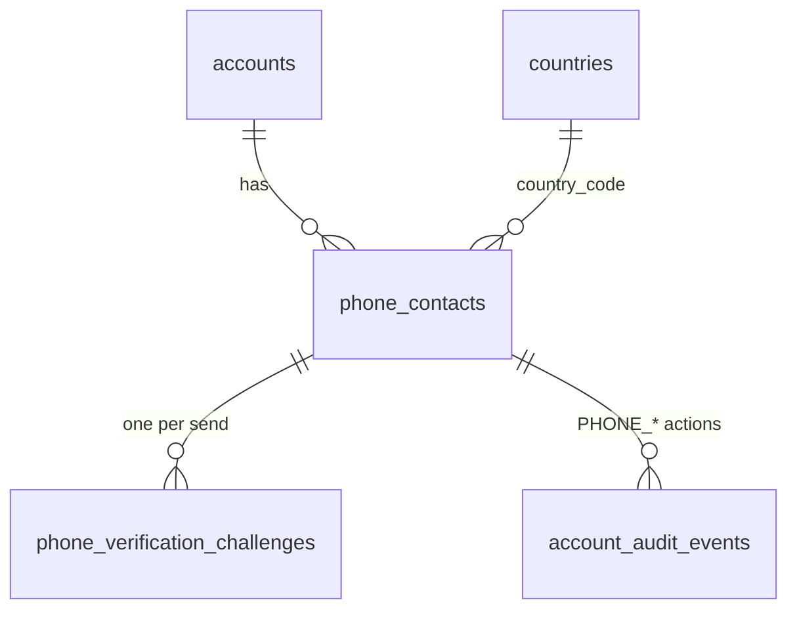

# Phone contact and verification

The phone contact (ID-003) is the mobile number BananaGig holds for a person and the proof, by an SMS code, that the person controls it. Keycloak remains the authentication authority and is NOT a phone store: the number is never written to Keycloak, a token, an event or a log. The email contact (ID-002, `EMAIL_VERIFICATION.md`) is the model this follows; the differences are the canonical form and country, the SMS delivery, the line-type policy and the configurable number of accounts per phone. ID-003 stores and exposes the state; it gates nothing (booking and provider onboarding gates will read the derived contacts summary).

Requirements served: CU-03.04 to CU-03.06 and CU-03 sign-up rules (mobile phone required, country selector from the market, stored in E.164, verified by an SMS code, masked number on the verify screen, "Change number"), SV-03.01 (code rules from configuration, single use, hashes only), SV-03.02 (the same phone cannot verify more than a configured number of accounts; numbers the partner identifies as non-mobile, virtual or high-risk can be blocked by market policy), SV-03.04 (rate limits by account, phone, IP and device), SV-03.05 (private, masked), SV-10.07 (phone entry and validation use the country lookup; the default comes from the market), CU-09.15 (a change is verified before it replaces the old number and the old one stays active until then).

A phone number is personal data. No code, hash or full number appears in a log line, an audit `changes` object, an event, an error or an API response. The API returns the number MASKED (`+*******0142`) to its owner only.

## Scope

In scope: the phone contact tables, E.164 canonicalization over a proven library, the country integration, the verification challenge (SMS code), resend and attempt limits, the line-type / risk policy and its adapter port, the accounts-per-number policy, the `SmsSender` port with the fake sink, the managed copy and configuration, four authenticated API operations, `phone` and the derived `contacts` summary on `GET /account/me`, five outbox events, audit, and the exact trusted-proxy model that makes the source-address limit meaningful.

Out of scope (nothing exists for any of these): password reset, MFA enrollment, onboarding and provider UI, a verification screen (no web page exists), SMS booking notifications, voice calling, account recovery, marketing SMS, booking gating, a production SMS provider (DEBT-0059), a telecom risk vendor (DEBT-0060).

## Ownership and trust boundary

| Question | Answer |
|---|---|
| Who owns the phone contact? | BananaGig: `identity.phone_contacts` |
| Is a phone number in Keycloak? | No. Tokens carry no phone claim and BananaGig never writes one to Keycloak. |
| When is a number VERIFIED? | Only by proof: the SMS code. There is no trusted-provider shortcut for phones (the `source` column has the single value `USER_ENTERED`). |
| Can a number be created already verified? | No. A guard refuses any insert except PENDING or REPLACEMENT_PENDING. |

## Canonical form

`canonicalizePhone` (`packages/accounts/src/phone.ts`) is the only normalization; its output is the comparison key, the uniqueness key, the SMS recipient and the stored value. It uses libphonenumber-js (MIT, pinned 1.13.14, `min` metadata, no dependencies). There are no custom dialing rules and no hardcoded calling code.

| Rule | Policy |
|---|---|
| Input characters | Unicode NFKC (full-width digits become ASCII), trimmed; only digits, a leading `+`, spaces, dots, dashes and parentheses; letters, extension markers (`x12`, `ext. 5`), control and bidirectional characters are refused (`INVALID_CHARACTERS`); at most 64 characters (`TOO_LONG`) |
| International number | starts with `+`; needs no country; a conflicting country hint is ignored |
| National number | read in the country the caller names (the market default of the form); with none, the platform default country; otherwise `COUNTRY_REQUIRED`. The default is the only ACTIVE country in geography (launch: the United States) |
| Validity | must be VALID for its numbering plan (`INVALID_NUMBER`), not merely well-formed; an extension is refused; a non-geographic range (+800) is refused (`COUNTRY_NOT_SUPPORTED`) |
| Result | `+` and the digits (E.164: 7 to 15 digits) and the ISO country the library resolves FROM THE NUMBER (a +1 416 number is CA), never the hint |
| Availability | the country must be ACTIVE in geography and its configured dialing code must equal the number's calling code (else `COUNTRY_NOT_SUPPORTED`) |
| Idempotent | canonicalizing the E.164 output gives the same value |

Display formatting is derived later from E.164 and the country; no national-number or formatted copy is stored. `maskPhone` (the plus sign, stars and the last four digits) is the only form that leaves the server.

## Data model

`identity.phone_contacts`: `phone_contact_id`, `account_id`, `phone_e164`, `country_code`, `status`, `is_primary`, `source`, `line_type`, `line_type_checked_at`, `verified_at`, `disabled_at`, `disabled_reason`, timestamps. `identity.phone_verification_challenges`: `challenge_id`, `phone_contact_id`, `purpose`, `code_hash`, `expires_at`, `used_at`, `attempt_count`, `invalidated_at`, `invalidation_reason`, `delivery_status`, `last_sent_at`, `created_at`, `correlation_id`. There is no magic-token column. Details, constraints and the review are in `docs/data/DATA_MODEL.md` and `docs/data/NORMALIZATION_LOG.md`.

The lifecycle is the email lifecycle (`PENDING`, `REPLACEMENT_PENDING`, `VERIFIED`, `DISABLED`; ADR-0027): the primary stays verified and active until the replacement verifies, then the old one becomes `DISABLED`/`REPLACED` in the same transaction; a withdrawn or superseded candidate becomes `DISABLED`/`SUPERSEDED`. Account level `phoneVerificationStatus`: `NONE`, `PENDING`, `VERIFIED` (derived from the rows).

### Uniqueness and accounts per number

| Case | Behaviour | Enforced by |
|---|---|---|
| Pending duplication | allowed across accounts; never counted; reveals nothing | no index |
| Verified duplication | at most `verification.phone.max_accounts_per_number` accounts (default 1, overridable per COUNTRY and MARKET) may hold one number VERIFIED; no takeover, no displacement | the service (advisory lock on the number, then a count of the OTHER accounts) and the guard trigger (same lock, the value the service passes in `app.phone_max_accounts`, structural ceiling 5) |
| Proving a number held elsewhere | `409 ACCOUNT_PHONE_UNAVAILABLE` AFTER a correct code; nothing changes; recovery is a support process (DEBT-0061) | the service pre-check and the trigger |
| Same account | one primary, one open candidate, one live row per number | partial unique indexes |
| Replacement | as for email | guard triggers and a deferred invariant trigger |

A CLOSED account does not hold its number: the service count and the guard trigger both ignore verified contacts of CLOSED accounts (a recycled number can be verified by its new owner), while a SUSPENDED account still holds it.

Before a correct code, add and send answer identically whatever any other account holds, and the per-number limiter counts sends regardless of ownership.

## Line type and risk policy

The market policy `verification.phone.blocked_line_types` (default `["VIRTUAL","HIGH_RISK"]`, a JSON list of `LANDLINE`, `VOIP`, `VIRTUAL`, `UNKNOWN`, `HIGH_RISK`; MOBILE is never blockable) is read for the number's COUNTRY. When it is not empty the number is classified by the `PhoneIntelligence` port BEFORE anything is stored or sent: a blocked type is `PHONE_NOT_ACCEPTED` (nothing stored, nothing sent); a lookup that fails or takes longer than five seconds is `PHONE_RISK_UNAVAILABLE` (fail closed, retryable). When the list is empty no lookup is made. The result is stored on the contact as a snapshot (`line_type`, `line_type_checked_at`) and re-applied at send and confirm without calling the vendor again, so tightening the policy takes effect for pending numbers that HAVE a snapshot. A number added while the list was empty has no snapshot (`line_type` is null) and is never blocked by a later tightening (DEBT-0065). Nothing is blocked globally beyond the configured default. Adapters: `FakePhoneIntelligence` (DEV/TEST: the last three digits choose the type: 901 VOIP, 902 VIRTUAL, 903 LANDLINE, 904 HIGH_RISK, 905 the lookup fails, otherwise MOBILE) and `UnknownPhoneIntelligence` (everything UNKNOWN, the production default until a vendor exists, DEBT-0060).

## Verification challenge

The hardened ID-002 challenge without the magic link (ADR-0028, ADR-0030): one challenge per send; the code (`verification.phone.code.length` digits from the CSPRNG) is shown once, in the SMS; only an HMAC-SHA-256 bound to the challenge id and keyed with `VERIFICATION_HASH_SECRET` is stored, in its own domain (`bananagig:phone-code:v1`), compared in constant time; single use under the row lock; wrong attempts counted atomically and committed although the call fails, the attempt that reaches `max_attempts` locks the challenge; an expired challenge counts no attempt; a code from an earlier SMS (superseded by a resend) is answered "used or replaced" and costs no attempt; a repeated successful confirmation is an idempotent success. Locking order: account row, the account's phone contacts, the challenge row, then the advisory lock of the number.

## Limits and abuse protection

| Limit | Where it is counted | Fails |
|---|---|---|
| Resend cooldown (`resend_seconds`, 30) | PostgreSQL: from the creation of the account's newest challenge that is neither FAILED nor used | `429 ACCOUNT_PHONE_RESEND_TOO_SOON` + `Retry-After` |
| Per hour (`max_per_hour`, 5) and per day (`max_per_day`, 10) | PostgreSQL: challenges created by the account (failed deliveries count) | `429 ACCOUNT_PHONE_SEND_LIMIT` + `Retry-After` |
| Wrong attempts (`max_attempts`, 5) | PostgreSQL: `attempt_count` | `429 ACCOUNT_PHONE_VERIFICATION_LOCKED` |
| Requests per account, per source address and per device per hour (`requests.max_per_hour`, 30). Since ID-004 the device dimension is fed with the application device id of the request's session (absent until the browser has registered; clearing the cookie yields a new device, so a new bucket: it bounds honest clients, not an attacker, DEBT-0054) | Valkey, the reusable limiter | `429 ACCOUNT_PHONE_RATE_LIMITED` |
| SMS to one number per hour across all accounts (`number.max_per_hour`, 5) | Valkey (HMAC of the E.164, never the raw number) | `429 ACCOUNT_PHONE_RATE_LIMITED` |

A send refused by the cooldown or a cap is detected BEFORE the limiter is consumed, so a refused request never spends the per-number budget. The limiter is consumed last, inside the send transaction, under the account lock and only after the cooldown and caps passed, for the number the text actually goes to (a number replaced between the first read and the lock aborts the send as a retryable `409 CONFLICT`); five concurrent sends therefore send one text and spend the budget once. Setting the number and sending fail CLOSED when the limiter is unreachable (an SMS costs money); confirmation fails open (the attempt counter bounds it). The values are CFG-001 parameters (CRITICAL, second approver, owner security; the two policy parameters owner trust): the six code-policy values are the PRD defaults, the last two limits are an engineering assumption (DEBT-0064). Differences from email: a per-NUMBER budget (an SMS costs money and pumping targets a number, not an account), no per-address mailbox equivalent, and the exact trusted-proxy model below.

## Source address (DEBT-0055)

The source-address dimension counts `request.ip`. `TRUSTED_PROXY_HOPS` is the exact number of reverse proxies in front of the API; Fastify trusts `hop < hops`, so `request.ip` is the socket address with 0 hops and the last `X-Forwarded-For` entry (the one the proxy wrote) with 1; a client-chosen leftmost entry is never used. Caddy REPLACES the header (`header_up X-Forwarded-For {remote_host}`), the web server forwards one value, and the API is reachable only through the proxy (no published API port). Production must set the value explicitly. See ADR-0033 and `RATE_LIMITING.md`.

## Delivery

`SmsSender` (`@bananagig/platform`) is the provider-neutral port: `to` (E.164), `templateKey`, typed `variables`, `locale`, `correlationId`. `RenderingSmsSender` renders `sms.verification.phone.body` from the content registry (variables `verification_code`, `expiry_minutes`; one short segment; no link, no account id) and hands the text to an `SmsTransport`. Today: `ValkeyFakeSmsTransport` (`SMS_TRANSPORT=fake`, DEV/TEST only, refused in production) appends the text to a Valkey list keyed by a SHA-256 of the number with a 15-minute TTL; tests and the smoke test read it with `FakeSmsInbox` (`@bananagig/testing/sms`); `DisabledSmsTransport` (`SMS_TRANSPORT=disabled`, the production default) fails every send with `503 ACCOUNT_PHONE_DELIVERY_FAILED` (not retryable). Sending is two-phase as for email: the challenge commits, the SMS is delivered outside any transaction, then the outcome is recorded; a failed delivery closes its challenge and starts no cooldown. See ADR-0032.

## Content and configuration

No user-visible copy is written in code: 33 managed entries (`sms.verification.phone.body`, `account.phone.verify.*`, `account.phone.status.*`, `account.phone.error.*`) are seeded by migration 0011 through the real lifecycle. The ten `verification.phone.*` parameters are seeded through the real change workflow (see `CONFIGURATION.md`). Country-scoped values resolve with the number's country; a market override applies when accounts have a market (DEBT-0063).

## API

All operations are under `/api/v1/account`, authenticated (web identity context), act on the caller's own account only, validate bodies strictly BEFORE Ajv can coerce them, and answer `Cache-Control: no-store`.

| Operation | Purpose |
|---|---|
| `GET /account/phone` | the phone state: status, masked primary and pending number, `resendAvailableAt`, `attemptsRemaining`, `codeLength`, `validityMinutes` |
| `POST /account/phone` `{phone, country?}` | set the number to verify: the first number (`INITIAL_PHONE`) or a pending replacement (`CHANGE_PHONE`); sends nothing |
| `POST /account/phone/verification/send` `{}` | send or resend the verification SMS |
| `POST /account/phone/verification/confirm-code` `{code}` | confirm with the code |

`GET /account/me` carries `phone: { phoneVerificationStatus, primary, pending }` (masked) and `contacts: { emailVerified, phoneVerified, contactsVerified }`. `contacts` is DERIVED from the two statuses at read time (`deriveContactsVerification`): no `contacts_verified` column exists, so it cannot drift. Error codes are `ACCOUNT_PHONE_*` with a managed message key in `details.messageKey` and `Retry-After` on the 429s; refusals that reveal nothing about other accounts (`PHONE_NOT_ACCEPTED`, `PHONE_RISK_UNAVAILABLE`) carry no line type.

## Events and audit

Transactional outbox, aggregate `identity_account`, identifiers only: `bananagig.identity.phone-contact-added.v1`, `phone-verification-sent.v1`, `phone-verified.v1`, `phone-verification-failed.v1`, `phone-change-requested.v1`. Audit gains `PHONE_ADDED`, `PHONE_CHANGE_REQUESTED`, `PHONE_VERIFICATION_REQUESTED`, `PHONE_VERIFICATION_FAILED`, `PHONE_VERIFICATION_LOCKED`, `PHONE_VERIFIED`, `PHONE_PRIMARY_CHANGED` with the contact id and, in `changes`, the masked number, the country, statuses, purpose, line type (when looked up) and attempt numbers.

## Tests

Unit: canonicalization tables, masking, strict request validation, policy parsing, the shared primitives (with pinned email hash values), the window evaluation, the SMS and intelligence adapters, the API layer, the proxy-trust semantics and the Caddyfile. Integration: the data model (constraints, guards, the number cap under concurrency, seeds), the service (every flow and race), the HTTP API with the fake sink and Valkey, DEBT-0055 over HTTP. Smoke: the `Phone verification` scenario (real tokens, the fake sink, line-type refusals, a spoofed header through Caddy, no number or code in responses or Loki).

## Operations

- A production environment must set `SMS_TRANSPORT`, `PHONE_INTELLIGENCE` (fake values are refused there) and `TRUSTED_PROXY_HOPS`; until a provider exists every send fails clearly.
- Changing a limit or the accounts-per-number / blocked-line-type policy is a configuration change request (second approver), not a deployment.
- The fake sink and the fake classifier must never be enabled in a shared or production environment.
