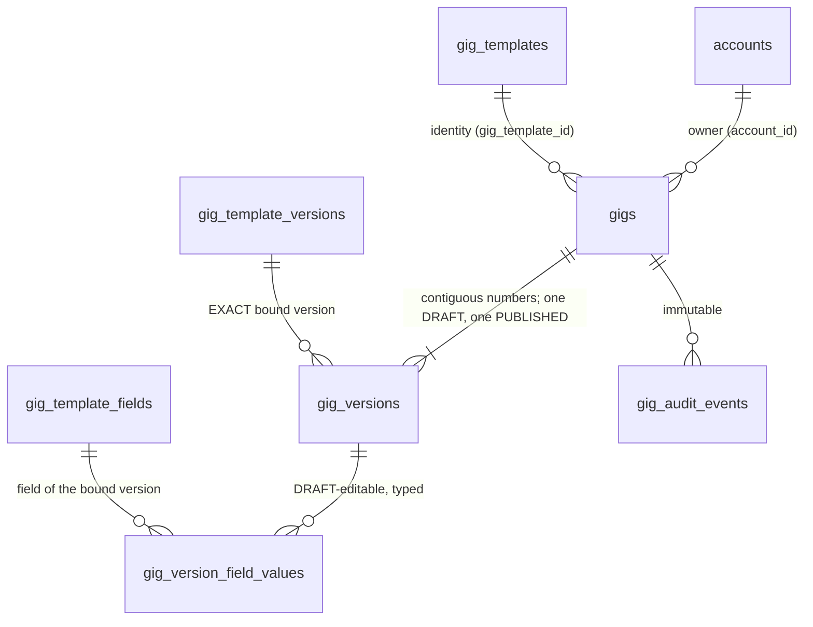
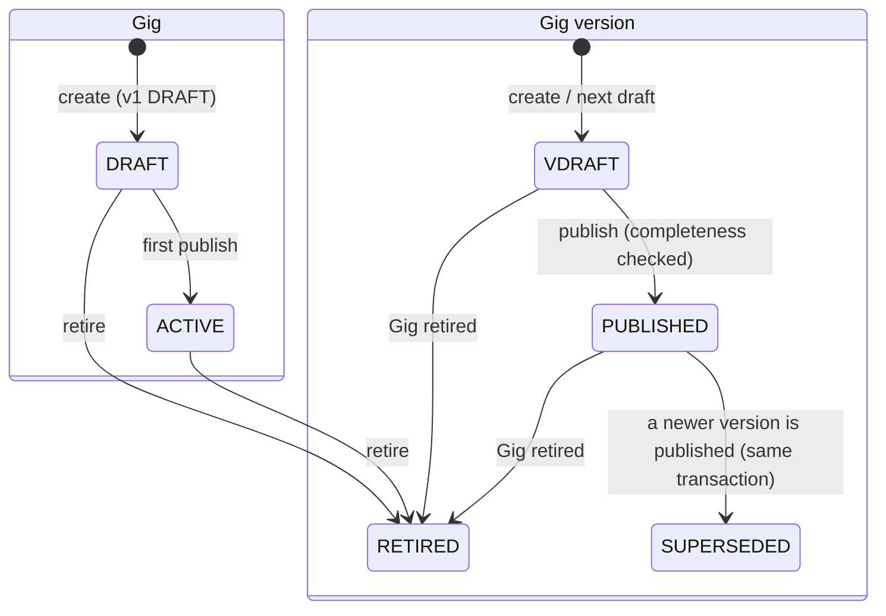

# Provider Gigs and the GigMenu (CAT-003)

How a provider builds the offer ("Gig") it sells from a PLATFORM-OWNED Gig Template, keeps its history as immutable versions, and sees the list (the GigMenu). Owner: the `provider` schema and `@bananagig/provider` (`gig-*` files). Canonical decision: [ADR-0046](../architecture/ADR-0046-provider-gig-versions-bind-immutably-to-exact-gig-template-versions.md). PRD: PR-03 (Gig builder and GigMenu), PR-03.02 (prefilled from the template), PR-03.05 (several Gigs), PR-03.06 (pitch limits), PR-03.12 and R-06 (a change never rewrites history). The structure a Gig is built from is [GIG_TEMPLATES.md](GIG_TEMPLATES.md) (ADR-0041); the provider account it belongs to is [PROVIDER_REGISTRATION.md](PROVIDER_REGISTRATION.md) (ADR-0042).

## The principle: a Gig is not live, not bookable, and never rewritten

A Gig is **provider-owned content built on platform-owned structure**. Publishing one records an offer; it does **not** make the provider live or bookable. Go-Live (PRO-003) is a separate, later decision, and every response says `goLive: { evaluated: false, eligible: false }`. Variants, add-ons, media, service areas, availability, search and booking are later checkpoints.

Three levels, three owners (the template side is in GIG_TEMPLATES.md):

| Level | Owner | Where |
| --- | --- | --- |
| Service type | Platform | `catalog.service_types` (CAT-001) |
| Gig Template and its frozen versions | Platform | `catalog.gig_templates`, `catalog.gig_template_versions` (CAT-002) |
| **Gig**, its versions and field values | **Provider** | `provider.gigs`, `provider.gig_versions`, `provider.gig_version_field_values` (CAT-003) |

## Model

- **Identity** (`provider.gigs`): `account_id`, `gig_template_id`, `status`, optional `client_request_id`. It stores **no service type** (reached through the template) and **no market** (the provider's market is the market of the account's COMPLETED registration, `provider.registrations.market_id`).
- **Version** (`provider.gig_versions`): `version_number` (contiguous, 1, 2, 3), the **exact** `gig_template_version_id`, `status`, `revision` (draft token), the provider copy (`title`, `short_pitch`, `description`), `price_amount_minor` + `price_currency`, `duration_minutes`, and the lifecycle timestamps. Nothing is hard-deleted.
- **Field values** (`provider.gig_version_field_values`): one typed row per (version, template field) that has a value; exactly one typed column is set (text, integer, decimal, boolean, option code, duration). Only PROVIDER_CONFIGURABLE and PROVIDER_REQUIRED fields of the bound version can have a row. **PLATFORM_FIXED values are never copied**: the view resolves them from the bound template version (`fields[].fixed = true`).
- **Audit** (`provider.gig_audit_events`): immutable (UPDATE, DELETE and TRUNCATE refused).
- No "current version" pointer: the current version is the one PUBLISHED row (partial unique index), the editable one is the one DRAFT row (partial unique index).

## Exact template version binding (the owner decision)

- **v1 binds the template's ACTIVE version at creation.** Creation needs: template ACTIVE, service type ACTIVE, an ACTIVE version, the template enabled in the provider's market and the service type among the registration's selected service types.
- **v(n+1) binds the SAME template version as v(n).** There is **no auto-migration**: when the template later gets a newer version (the bound one becomes SUPERSEDED) or is retired, the Gig keeps what it was built from and keeps working. A provider who wants a newer structure creates a new Gig; adopting a newer template version on an existing Gig is a later checkpoint (DEBT-0091).
- **A SUPERSEDED bound version still publishes. A RETIRED bound version, a RETIRED template or a RETIRED service type blocks publishing** (a DB guard under `FOR SHARE` locks makes this race-safe; the draft stays readable and editable text-wise but cannot be published).
- Every read works for the owner in every state, including after the Gig or its template is retired.

## Lifecycle

- Gig status: `DRAFT` (no version published yet) -> `ACTIVE` (first publish) -> `RETIRED` (terminal). **Reactivation is not supported**: a provider who wants the offer again creates a new Gig. There is no INACTIVE / pause state (the PRD has none).
- Version status: `DRAFT` -> `PUBLISHED` -> `SUPERSEDED`; `DRAFT | PUBLISHED` -> `RETIRED` only as a consequence of retiring the Gig. `SUPERSEDED` versions stay as they are when the Gig is retired.
- At most **one DRAFT and one PUBLISHED** version per Gig (partial unique indexes). Publishing v(n+1) supersedes v(n) in the same transaction, so a reader never sees zero or two published versions.
- A published version is frozen by the database (content, price, duration and its field values). The fix is the next draft.
- Several Gigs per account and per template are allowed (PR-03.05).

## Rules

### Eligibility

To create or publish: the account is ACTIVE; the PROVIDER membership is ACTIVE (`AccountPort.facts`); a COMPLETED provider registration exists with a market; the template's service type is among its selected service types; the template is enabled in that market. Verification, subscription, profile and Go-Live are **not** required.

| Refusal | `details.reason` |
| --- | --- |
| `PROVIDER_NOT_ELIGIBLE` | `ROLE_NOT_ACTIVE`, `REGISTRATION_NOT_COMPLETED`, `SERVICE_NOT_SELECTED` |
| `GIG_TEMPLATE_NOT_AVAILABLE` | `TEMPLATE_RETIRED`, `TEMPLATE_INACTIVE`, `TEMPLATE_NOT_IN_MARKET`, `SERVICE_TYPE_NOT_ACTIVE`, `NO_ACTIVE_VERSION` |

### Caps (configuration)

`provider.gig.max_active` bounds Gigs in `ACTIVE` status (checked at the **first** publish); `provider.gig.max_drafts` bounds versions in `DRAFT` status across the account (checked at Gig creation and at next-draft creation). Both are counted under the **account row lock**, so concurrent requests cannot exceed them. A cap is `409 LIMIT_REACHED`.

### Saving a draft (`PUT`, eager validation)

The request **replaces** the whole editable content; an omitted field value is cleared. A draft may be incomplete (null or empty is allowed), but any value present must be valid:

- Text: `normalizeProviderText` (Unicode NFC, outer whitespace trimmed; single-line text also collapses whitespace runs; control, bidirectional and other invisible format characters except the joiners, unpaired surrogates and HTML-looking markup are refused; text with nothing visible counts as empty; the check is linear, a regression test feeds it 80,000 hostile characters: LRN-0060). Title, short pitch and TEXT fields are single-line; description and LONG_TEXT are multi-line. Limits are in code points and come from configuration.
- Field bounds (`minLength`, `maxLength`, `minNumber`, `maxNumber`) come from the **exact bound template version**. ENUM values must be an option code of **that version's** field.
- A value for a PLATFORM_FIXED field, an unknown field key or an unsupported field type is refused (`VALIDATION_FAILED`, `details.issues[].reason` = `FIELD_NOT_PROVIDER_EDITABLE`, `FIELD_UNKNOWN`, `FIELD_TYPE_NOT_SUPPORTED`).
- A PROVIDER_CONFIGURABLE field with no value is **unset**; the template default is a hint only and is not stored.
- `expectedRevision` must match the draft's revision, else `409 STALE_DRAFT`.

### Field support matrix

| Template field type | CAT-003 | Stored in | Value in the API |
| --- | --- | --- | --- |
| `TEXT` | supported | `text_value` | single-line string |
| `LONG_TEXT` | supported | `text_value` | multi-line string |
| `INTEGER` | supported | `integer_value` | integer |
| `DECIMAL` | supported | `decimal_value` | string `^-?[0-9]{1,15}(\.[0-9]{1,6})?$` (never a float) |
| `BOOLEAN` | supported | `boolean_value` | boolean |
| `ENUM` | supported | `option_code` | option code of the bound version's field |
| `DURATION` | supported | `duration_minutes` | integer minutes |
| `MONEY` | not supported (the Gig price is a column) | none | none |
| `MEDIA`, `EQUIPMENT_REFERENCE`, `SKILL_REFERENCE` | not supported (CAT-004 and later) | none | none |

An **optional** unsupported field is simply not editable. A **PROVIDER_REQUIRED** unsupported field blocks publishing with issue `FIELD_TYPE_NOT_SUPPORTED` (DEBT-0089): such a template cannot be published as a Gig until the type is supported. Bounds are checked by the service, not the database (the database checks type, template membership, behaviour and option validity).

### Price and duration

- **Price** is `price_amount_minor` (integer, no floats) + `price_currency`. It is permitted only when the bound version allows `FIXED` or `FIXED_WITH_VARIANTS` pricing (else `PRICE_NOT_PERMITTED`). `amountMinor` >= 0 in a draft, **> 0 at publish** and at most 10^12 minor units (`GIG_PRICE_MINOR_CEILING`, a structural bound; the configurable floor and ceiling are DEBT-0092). The currency is **never accepted from the client**: the server sets it from `geography.markets.currency_code` of the provider's market at save time, and a database guard checks it. No dynamic or group pricing, discounts, drops, credits, floor price or base-price logic here.
- **Duration** (`duration_minutes`) is Gig-level. Permitted only when the bound version has a minimum, maximum or suggested duration. If a minimum and/or maximum is present the value must lie within them; if only a suggestion is present, any integer 1 to 100000 is accepted and the suggestion is shown as a hint (the 1..100000 CHECK is an integrity bound, not policy).

### Publishing (`POST .../publish`)

`expectedRevision` must match (else `STALE_DRAFT`; a double publish gets `STALE_DRAFT` or `NO_DRAFT`, never a second PUBLISHED version). Blocking checks: the Gig is not RETIRED; the bound template version, template and service type are not RETIRED; caps. Completeness: title, short pitch and description non-empty and within their configured lengths; every supported PROVIDER_REQUIRED field has a value; a price > 0 when the version allows pricing; a duration when the version has any duration fact. Failing completeness is `422 PUBLISH_BLOCKED` with `details.issues[]` (`target`, `fieldKey?`, `reason`, `messageKey`): identifiers only, never provider text. The draft DTO carries `publishable` and the same `issues` so the editor can show them before the attempt.

### Provider copy

`title`, `short_pitch` and `description` are provider-owned **plain text** columns on the version, not CFG-002 content. Limits are configuration (defaults 100, 1000, 5000 code points; structural ceilings 200, 2000, 20000). Moderation is a recorded requirement, not built (DEBT-0090). **Provider text never appears in an audit row, an event, a log, an error detail or a metric.**

### Retiring (`POST .../retire`)

Takes no input (free text would end up in the immutable audit). The Gig becomes RETIRED; its DRAFT and PUBLISHED versions become RETIRED; SUPERSEDED versions stay. History remains readable.

### Idempotency

`clientRequestId` (optional uuid on create) is unique per account; a replay returns the existing Gig (`created: false`, HTTP 200 instead of 201).

## Policy is configuration (CFG-001)

Typed PLATFORM parameters, read fresh, **failing closed** (`503 UNAVAILABLE`, `reason POLICY_INVALID`) when missing or invalid; no code default exists:

| Key | Type | Seed | Range | Meaning |
| --- | --- | --- | --- | --- |
| `provider.gig.max_active` | INTEGER | `25` | 1..500 | Gigs in ACTIVE status per account |
| `provider.gig.max_drafts` | INTEGER | `10` | 1..500 | Versions in DRAFT status per account |
| `provider.gig.title.max_length` | INTEGER | `100` | 1..200 | Title, in code points |
| `provider.gig.short_pitch.max_length` | INTEGER | `1000` | 1..2000 | Short pitch (PR-03.06) |
| `provider.gig.description.max_length` | INTEGER | `5000` | 1..20000 | Description |

All platform labels (statuses, errors, issue messages, page copy) are registry content under `provider.gig.*`; the API returns **keys** (`statusKey`, `messageKey`, `labelContentKey`), the web resolves them.

## API (`/api/v1/provider`, tag `provider`)

Owner-only: every route acts on the account of the verified token (`requireAccount`, the active-role header is not honoured). **No route accepts an account id, a role, a status or a currency**; bodies and params are strict. Every response, errors included, is `Cache-Control: no-store`. Another account's Gig or version is `404 GIG_NOT_FOUND` / `GIG_VERSION_NOT_FOUND`, never 403, never revealing existence.

| Route | Purpose |
| --- | --- |
| `GET /gig-templates` | Templates the provider can start a Gig from now (`GigTemplateChoicesResponse`) |
| `GET /gigs` | The GigMenu: rows, readiness, limits, `canCreate` (`GigMenuResponse`) |
| `POST /gigs` | `{gigTemplateCode, clientRequestId?}` -> `201` (`200` on idempotent replay) |
| `GET /gigs/:gigId` | One Gig: current version, draft, history |
| `POST /gigs/:gigId/versions` | Body `{}`: the next draft, copied from the published version (same template version) -> `201` |
| `GET /gigs/:gigId/versions/:version` | One version (read-only for non-drafts) |
| `PUT /gigs/:gigId/draft` | `UpdateGigDraftRequest` (whole editable content + `expectedRevision`) |
| `POST /gigs/:gigId/publish` | `{expectedRevision}` |
| `POST /gigs/:gigId/retire` | Body `{}` |

Errors (wire code = the contract code if it starts with `GIG_`, else `GIG_<code>`; `details` is an allow-list: `reason`, `field`, `issues`, `limit`, `code`, `messageKey`): `GIG_NOT_FOUND`, `GIG_VERSION_NOT_FOUND`, `GIG_TEMPLATE_NOT_FOUND` 404; `GIG_PROVIDER_NOT_ELIGIBLE`, `GIG_ACCOUNT_NOT_ACTIVE` 403; `GIG_TEMPLATE_NOT_AVAILABLE`, `GIG_RETIRED`, `GIG_DRAFT_EXISTS`, `GIG_NO_DRAFT`, `GIG_STALE_DRAFT`, `GIG_LIMIT_REACHED`, `GIG_PUBLISH_BLOCKED` (the error model has no 422), `GIG_CONFLICT` 409; `GIG_VALIDATION_FAILED` 400; `GIG_UNAVAILABLE` 503. Exact statuses are in the generated `docs/api/openapi.yaml`, the source of truth.

The GigMenu is one read for the whole list (a constant number of queries, no per-Gig lookups). It is owner-only and is **not** a public listing or search.

## Readiness for the onboarding and Go-Live

`getGigReadinessFacts` returns `{ hasPublishedGig, publishedGigCount, draftVersionCount, goLive: { evaluated: false, eligible: false } }`: facts only. The registration's `GIGS` onboarding step is wired to it through `gigsPrerequisite` (`NOT_STARTED`, `IN_PROGRESS`, `COMPLETE`; never `BLOCKED`, and it never blocks registration submit). PRO-003 decides what these facts mean for Go-Live.

## Template trust requirements

The bound version's requirement hooks are exposed read-only in `GigTemplateLinkDto.requirements` (opaque). Trust is neither duplicated nor evaluated here (TRUST-001, PRO-003).

## Audit and events

- **Audit** (`provider.gig_audit_events`, immutable): `GIG_CREATED`, `GIG_DRAFT_CREATED`, `GIG_DRAFT_UPDATED`, `GIG_VERSION_PUBLISHED`, `GIG_VERSION_SUPERSEDED`, `GIG_RETIRED`; actor `account:<id>`; `changes` holds only ids, changed field **names**, counts, revision and version number, never text or amounts. One row per real change, in the same transaction; none for no-ops or reads.
- **Events** (outbox, same transaction, identifiers only; `docs/events/asyncapi.yaml`): `bananagig.provider.gig-created.v1`, `bananagig.provider.gig-version-published.v1` (with `supersededGigVersionId` or null), `bananagig.provider.gig-retired.v1`. Draft edits emit nothing.

## Concurrency and locking

External reads (policy, account facts, template structures through `GigTemplatePort`) happen **before** the transaction; catalogue reads open repeatable-read snapshots that cannot nest. Inside every mutation the lock order is `identity.accounts` `FOR UPDATE` -> `provider.gigs` `FOR UPDATE` -> `provider.gig_versions`; catalogue rows are read `FOR SHARE`. Race-sensitive rules (template or service type retirement) are re-checked by the database guards. Every query filters by the authenticated account.

## Database rules (`provider_rule:<KEY>`)

The guards report `provider_rule:<KEY>` in the error DETAIL and the service maps the key, never the driver message. The keys include the account/template/service type checks (`ACCOUNT_NOT_ACTIVE`, `TEMPLATE_NOT_ACTIVE`, `SERVICE_TYPE_NOT_ACTIVE`, `SERVICE_NOT_SELECTED`, `REGISTRATION_NOT_COMPLETED`), the machines and immutability (`STATUS_TRANSITION`, `VERSION_FROZEN`, `REVISION`, `VERSION_NUMBER`, `NEW_NOT_DRAFT`, `GIG_RETIRED`, `NO_DELETE`), the template binding (`TEMPLATE_VERSION_MISMATCH`, `TEMPLATE_VERSION_RETIRED`), the content checks (`PRICE_CURRENCY`, `PRICE_NOT_PERMITTED`, `DURATION_NOT_PERMITTED`, `DURATION_RANGE`) and the field value checks (`FIELD_NOT_IN_TEMPLATE_VERSION`, `FIELD_FIXED`, `FIELD_TYPE_UNSUPPORTED`, `FIELD_TYPE_MISMATCH`). The migration and `docs/data/DATA_DICTIONARY.md` are the authoritative list.

## Web (temporary, minimal)

`/provider/gigs` (GigMenu with limits, the "Publishing a Gig does not put you live" note and a create-from-template form), `/provider/gigs/[gigId]` (current version, history, draft editor, next draft, retire) and `/provider/gigs/[gigId]/versions/[version]` (read-only), posting to same-origin web handlers with strict forms, closed lists of notice and error words and 303 redirects. Provider text never goes into a redirect, cookie or log. Labels are bound to inputs, errors are associated with the fields and summarised, targets are 44 px. The polished experience (rich text, media, variants) is a later checkpoint.

## Extension points

- **CAT-004** (variants, add-ons, media, bundles): new tables keyed by `gig_version_id`, so they are versioned with the Gig; the `MONEY`, `MEDIA`, `EQUIPMENT_REFERENCE` and `SKILL_REFERENCE` field types become supported there. Today a required unsupported field blocks publishing.
- **Template adoption** (moving a Gig to a newer template version): a later checkpoint; it must create a NEW Gig version bound to the new template version, validate it against that version, and be an explicit provider act. Nothing here migrates automatically.
- **PRO-003** (Go-Live): reads the readiness facts and the requirement hooks; owns the decision. Nothing here sets a live flag.
- **Search, service areas, availability, booking, public Gig pages**: derive from PUBLISHED versions and the `gig-version-published` event; nothing reads draft rows.
- **Moderation**: reviews the copy columns of a version before or after publication (a recorded requirement).

## Known limits

- A bound template version that is SUPERSEDED still publishes, so live Gigs can sit on an older structure indefinitely until adoption exists (owner decision, ADR-0046).
- A template whose required fields include an unsupported type cannot be published as a Gig yet.
- Wording of template labels is shared by all template versions (DEBT-0084), so a label text change reaches a Gig built on an older version.
- Field bounds (length and numeric limits of the bound template version) are validated by the service, not the database; the database checks type, template membership, behaviour and option validity only.
- The web editor is minimal and temporary (DEBT-0094); it takes the price as whole minor units (digits only) labelled with the currency, because the API does not expose currency digits (DEBT-0095).
- The write routes have no rate limit (DEBT-0030).
- Out-of-scope items and accepted limits are recorded as DEBT-0089 to DEBT-0096.

## Testing

Run the files rather than quoting counts: the contracts (`packages/contracts/src/gig.test.ts`), the database model (`packages/testing/src/gig-model.itest.ts`), the service (`packages/provider/src/gig.test.ts`, `gig.itest.ts`), the API (`apps/api/src/gig.test.ts`, `gig.itest.ts`), the web handlers and pages, and the smoke scenario `Provider GigMenu`. Commands: `pnpm --filter @bananagig/provider test`, one integration file with `node --env-file-if-exists=.env.host node_modules/vitest/vitest.mjs run -c vitest.integration.config.ts <file>`, `pnpm smoke`.

## Troubleshooting

| Symptom | Likely cause |
| --- | --- |
| 403 `PROVIDER_NOT_ELIGIBLE` | the account has no ACTIVE PROVIDER role, no COMPLETED registration, or did not select the template's service type (`details.reason`) |
| 409 `GIG_TEMPLATE_NOT_AVAILABLE` | the template is retired or paused, not enabled in the provider's market, its service type is not ACTIVE, or it has no ACTIVE version (`details.reason`) |
| 409 `STALE_DRAFT` | the draft changed since it was read: read it again and re-apply |
| 409 `DRAFT_EXISTS` / `NO_DRAFT` | the Gig already has an editable draft / there is no draft to save or publish: create the next draft first |
| 409 `LIMIT_REACHED` | the configured cap is reached (`provider.gig.max_active` or `max_drafts`) |
| 409 `GIG_RETIRED` | a retired Gig is terminal: create a new Gig |
| 409 `GIG_PUBLISH_BLOCKED` | read `details.issues` (missing copy, price, duration, required field, or a required field type not supported yet) |
| 400 `VALIDATION_FAILED` | a value is invalid for the bound template version (`details.issues`: fixed field, unknown field, option, bounds) |
| 404 `GIG_NOT_FOUND` | the Gig does not exist **or belongs to another account** (indistinguishable by design) |
| 503 `UNAVAILABLE` (`POLICY_INVALID`) | a `provider.gig.*` parameter is missing or out of range |
| a template does not appear in the choices | it is not ACTIVE, has no ACTIVE version, is not enabled in the provider's market, or its service type is not among the registration's selections |

## Not here

Variants, add-ons, bundles, media, service areas and radius, availability and capacity, the search projection and ranking, booking, subscriptions, Banana Credits, Go-Live (PRO-003), the public profile and public Gig pages, moderation, a rich text editor, template adoption or migration, price floors and instant-book rules.
