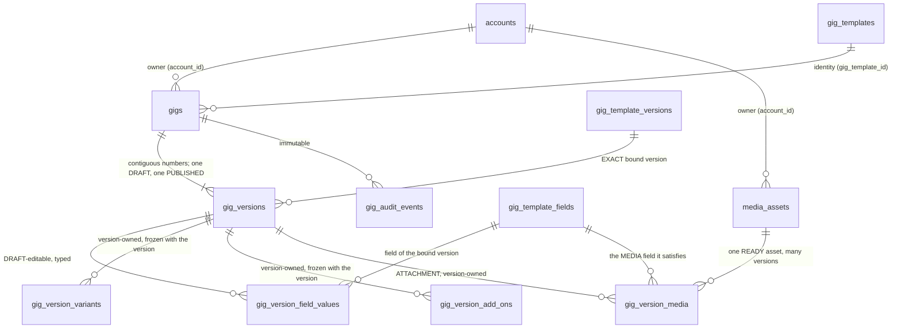
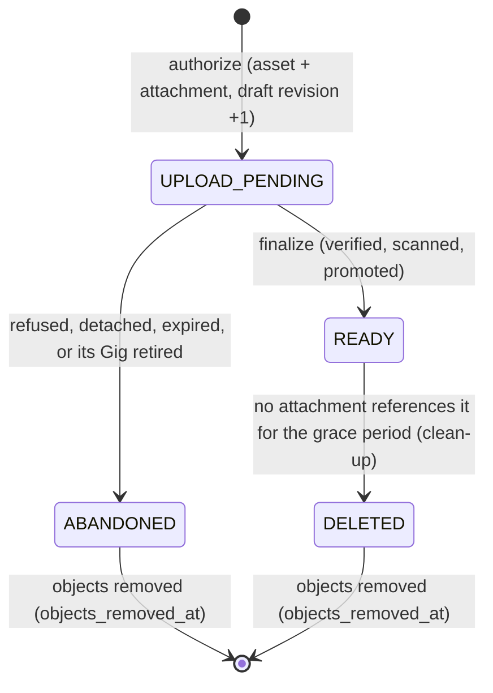
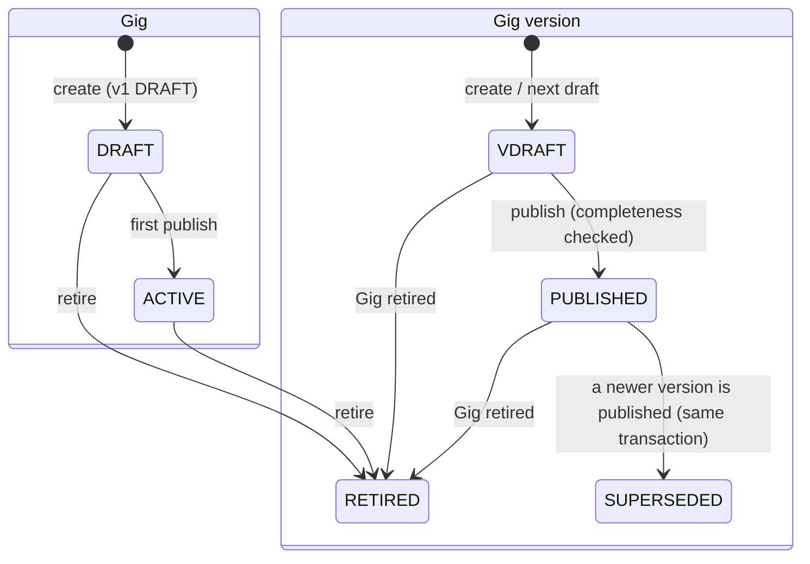

# Provider Gigs and the GigMenu (CAT-003, CAT-004)

How a provider builds the offer ("Gig") it sells from a PLATFORM-OWNED Gig Template, keeps its history as immutable versions, adds variants, add-ons and photos to a version, and sees the list (the GigMenu). Owner: the `provider` schema and `@bananagig/provider` (`gig-*` files). Canonical decisions: [ADR-0046](../architecture/ADR-0046-provider-gig-versions-bind-immutably-to-exact-gig-template-versions.md) (versions bind to an exact template version) and [ADR-0047](../architecture/ADR-0047-gig-variants-add-ons-and-photos-are-version-owned-provider-data-with-immutable-media-assets-in-private-storage.md) (variants, add-ons and photos are version-owned; photo bytes are immutable private assets). PRD: PR-03 (Gig builder and GigMenu), PR-03.02 (prefilled from the template), PR-03.05 (several Gigs), PR-03.06 (pitch limits), PR-03.07 (photo gallery), PR-03.08 (variants and add-ons), PR-03.12 and R-06 (a change never rewrites history). The structure a Gig is built from is [GIG_TEMPLATES.md](GIG_TEMPLATES.md) (ADR-0041); the provider account it belongs to is [PROVIDER_REGISTRATION.md](PROVIDER_REGISTRATION.md) (ADR-0042). Product direction: [BananaGig_PRD_TRP_Alignment.md](../product/BananaGig_PRD_TRP_Alignment.md) (BananaDrop is a core domain that CONSUMES this one: see "BananaDrop readiness").

## The principle: a Gig is not live, not bookable, and never rewritten

A Gig is **provider-owned content built on platform-owned structure**. Publishing one records an offer; it does **not** make the provider live or bookable. Go-Live (PRO-003) is a separate, later decision, and every response says `goLive: { evaluated: false, eligible: false }`. A published Gig version is a complete, immutable offer: copy, price, duration, field values, **variants, add-ons and photos**. Service areas, availability, search and booking are later checkpoints.

Three levels, three owners (the template side is in GIG_TEMPLATES.md):

| Level                                                                           | Owner        | Where                                                                                                                                                                   |
| ------------------------------------------------------------------------------- | ------------ | ----------------------------------------------------------------------------------------------------------------------------------------------------------------------- |
| Service type                                                                    | Platform     | `catalog.service_types` (CAT-001)                                                                                                                                       |
| Gig Template and its frozen versions                                            | Platform     | `catalog.gig_templates`, `catalog.gig_template_versions` (CAT-002)                                                                                                      |
| **Gig**, its versions, field values, **variants, add-ons and photo attachments** | **Provider** | `provider.gigs`, `provider.gig_versions`, `provider.gig_version_field_values` (CAT-003); `provider.gig_version_variants`, `gig_version_add_ons`, `gig_version_media` (CAT-004) |
| **Photo bytes** (an asset owned by the account, shared by attachment)           | **Provider** | `provider.media_assets` (CAT-004)                                                                                                                                       |

## Model



- **Identity** (`provider.gigs`): `account_id`, `gig_template_id`, `status`, optional `client_request_id`. It stores **no service type** (reached through the template) and **no market** (the provider's market is the market of the account's COMPLETED registration, `provider.registrations.market_id`).
- **Version** (`provider.gig_versions`): `version_number` (contiguous, 1, 2, 3), the **exact** `gig_template_version_id`, `status`, `revision` (draft token), the provider copy (`title`, `short_pitch`, `description`), `price_amount_minor` + `price_currency`, `duration_minutes`, and the lifecycle timestamps. Nothing is hard-deleted.
- **Field values** (`provider.gig_version_field_values`): one typed row per (version, template field) that has a value; exactly one typed column is set (text, integer, decimal, boolean, option code, duration). Only PROVIDER_CONFIGURABLE and PROVIDER_REQUIRED fields of the bound version can have a row. **PLATFORM_FIXED values are never copied**: the view resolves them from the bound template version (`fields[].fixed = true`). A MEDIA field never has a value row.
- **Variants and add-ons** (`provider.gig_version_variants`, `provider.gig_version_add_ons`, same shape): `gig_version_id`, a stable `item_key`, `name`, `description`, `price_delta_minor` (bigint >= 0, at most 10^12), `duration_delta_minutes` (integer >= 0, at most 100000), `display_order` (>= 1). **No currency column, no JSON, no `updated_at`, no absolute price, no tier or Drop field.** `(gig_version_id, item_key)` and `(gig_version_id, display_order)` are unique. The row id (`variant_id`, `add_on_id`) is regenerated on every replace and every next-draft copy and is **not** an identity: the identity is `(gig_version_id, item_key)`.
- **Photo asset** (`provider.media_assets`): the bytes, owned by the account: `status` (`UPLOAD_PENDING` -> `READY` | `ABANDONED`, `READY` -> `DELETED`), `object_key` (always exactly `provider/gig-media/<media_asset_id>`), `mime_type`, `size_bytes`, `sha256`, `width`, `height`, `scan_status` (`PENDING`, `CLEAN`, `INFECTED`, `ERROR`), `upload_expires_at`, `ready_at`, and the two one-way removal markers `objects_removed_at` and `upload_key_removed_at` (migration 0022). The facts of the bytes are immutable once READY.
- **Photo attachment** (`provider.gig_version_media`): the API's **`mediaId`**. A version, an asset, the template MEDIA field it satisfies, `display_order`, `alt_text`. The same READY asset can be attached to several versions of the owner's Gigs, so the next draft copies no binary. `(gig_version_id, media_asset_id)` and `(gig_version_id, display_order)` are unique (the order key is `DEFERRABLE INITIALLY IMMEDIATE` so a whole-order reorder is one statement).
- **Audit** (`provider.gig_audit_events`): immutable (UPDATE, DELETE and TRUNCATE refused).
- No "current version" pointer: the current version is the one PUBLISHED row (partial unique index), the editable one is the one DRAFT row (partial unique index).

The asset id, `object_key`, `sha256` and any URL are **never** in a default payload, audit row, event, log or error detail.



## Exact template version binding (the owner decision)

- **v1 binds the template's ACTIVE version at creation.** Creation needs: template ACTIVE, service type ACTIVE, an ACTIVE version, the template enabled in the provider's market and the service type among the registration's selected service types.
- **v(n+1) binds the SAME template version as v(n).** There is **no auto-migration**: when the template later gets a newer version (the bound one becomes SUPERSEDED) or is retired, the Gig keeps what it was built from and keeps working. A provider who wants a newer structure creates a new Gig; adopting a newer template version on an existing Gig is a later checkpoint (DEBT-0091). The variant, add-on and photo rules are read from this **exact** version.
- **A SUPERSEDED bound version still publishes. A RETIRED bound version, a RETIRED template or a RETIRED service type blocks publishing** (a DB guard under `FOR SHARE` locks makes this race-safe; the draft stays readable and editable text-wise but cannot be published).
- Every read works for the owner in every state, including after the Gig or its template is retired.

## Lifecycle



- Gig status: `DRAFT` (no version published yet) -> `ACTIVE` (first publish) -> `RETIRED` (terminal). **Reactivation is not supported**: a provider who wants the offer again creates a new Gig. There is no INACTIVE / pause state (the PRD has none).
- Version status: `DRAFT` -> `PUBLISHED` -> `SUPERSEDED`; `DRAFT | PUBLISHED` -> `RETIRED` only as a consequence of retiring the Gig. `SUPERSEDED` versions stay as they are when the Gig is retired.
- At most **one DRAFT and one PUBLISHED** version per Gig (partial unique indexes). Publishing v(n+1) supersedes v(n) in the same transaction, so a reader never sees zero or two published versions.
- A published version is frozen by the database (content, price, duration, its field values, **and every variant, add-on and photo attachment**, also against DELETE). The fix is the next draft.
- **Children and the lifecycle (CAT-004).** Variants, add-ons and attachments are written only while the parent version is a DRAFT (`VERSION_FROZEN` otherwise). When the version becomes PUBLISHED, SUPERSEDED or RETIRED its children are frozen with it, so publishing v2 can never touch v1's rows. The next draft **copies** the variants and add-ons (same keys, same order, row ids regenerated) and **re-attaches** the same READY photo assets (same field, order and alt text; no binary copy; unfinished uploads are not copied). **Retiring** a Gig closes the unfinished uploads of its draft (the asset becomes ABANDONED, the attachment leaves the draft, the refusal is audited with the reason `GIG_RETIRED`, the objects are deleted after the commit); the published, superseded and retired versions keep their children and photos readable.
- Several Gigs per account and per template are allowed (PR-03.05).

## Rules

### Eligibility

To create or publish: the account is ACTIVE; the PROVIDER membership is ACTIVE (`AccountPort.facts`); a COMPLETED provider registration exists with a market; the template's service type is among its selected service types; the template is enabled in that market. Verification, subscription, profile and Go-Live are **not** required.

| Refusal                    | `details.reason`                                                                                |
| -------------------------- | ----------------------------------------------------------------------------------------------- |
| `PROVIDER_NOT_ELIGIBLE`    | `ROLE_NOT_ACTIVE`, `REGISTRATION_NOT_COMPLETED`, `SERVICE_NOT_SELECTED`                         |
| `GIG_TEMPLATE_NOT_AVAILABLE` | `TEMPLATE_RETIRED`, `TEMPLATE_INACTIVE`, `TEMPLATE_NOT_IN_MARKET`, `SERVICE_TYPE_NOT_ACTIVE`, `NO_ACTIVE_VERSION` |

### Caps (configuration)

`provider.gig.max_active` bounds Gigs in `ACTIVE` status (checked at the **first** publish); `provider.gig.max_drafts` bounds versions in `DRAFT` status across the account (checked at Gig creation and at next-draft creation). Both are counted under the **account row lock**, so concurrent requests cannot exceed them. A cap is `409 LIMIT_REACHED`.

### Saving a draft (`PUT`, eager validation)

The request **replaces** the whole editable content (copy, price, duration and field values; it does not touch variants, add-ons or photos); an omitted field value is cleared. A draft may be incomplete (null or empty is allowed), but any value present must be valid:

- Text: `normalizeProviderText` (Unicode NFC, outer whitespace trimmed; single-line text also collapses whitespace runs; control, bidirectional and other invisible format characters except the joiners, unpaired surrogates and HTML-looking markup are refused; text with nothing visible counts as empty; the check is linear, a regression test feeds it 80,000 hostile characters: LRN-0060). Title, short pitch and TEXT fields are single-line; description and LONG_TEXT are multi-line. Limits are in code points and come from configuration.
- Field bounds (`minLength`, `maxLength`, `minNumber`, `maxNumber`) come from the **exact bound template version**. ENUM values must be an option code of **that version's** field.
- A value for a PLATFORM_FIXED field, an unknown field key or an unsupported field type is refused (`VALIDATION_FAILED`, `details.issues[].reason` = `FIELD_NOT_PROVIDER_EDITABLE`, `FIELD_UNKNOWN`, `FIELD_TYPE_NOT_SUPPORTED`). A value for a **MEDIA** field is refused with `FIELD_MEDIA_NOT_A_VALUE`: photos have their own endpoints.
- A PROVIDER_CONFIGURABLE field with no value is **unset**; the template default is a hint only and is not stored.
- `expectedRevision` must match the draft's revision, else `409 STALE_DRAFT`. **Every effective child mutation (variants, add-ons, photo authorize, finalize, detach, reorder, alt text) raises the revision by exactly 1**, so the editor must send the revision it last read (the child calls return the new one).

### Field support matrix

| Template field type                          | Supported                                        | Stored in                                   | Value in the API                                               |
| -------------------------------------------- | ------------------------------------------------ | ------------------------------------------- | -------------------------------------------------------------- |
| `TEXT`                                       | supported                                        | `text_value`                                | single-line string                                             |
| `LONG_TEXT`                                  | supported                                        | `text_value`                                | multi-line string                                              |
| `INTEGER`                                    | supported                                        | `integer_value`                             | integer                                                        |
| `DECIMAL`                                    | supported                                        | `decimal_value`                             | string `^-?[0-9]{1,15}(\.[0-9]{1,6})?$` (never a float)        |
| `BOOLEAN`                                    | supported                                        | `boolean_value`                             | boolean                                                        |
| `ENUM`                                       | supported                                        | `option_code`                               | option code of the bound version's field                       |
| `DURATION`                                   | supported                                        | `duration_minutes`                          | integer minutes                                                |
| `MEDIA`                                      | supported **as attachments** (CAT-004), never as a value | `provider.gig_version_media`         | none in `fieldValues`; photos in `media[]` (`FIELD_MEDIA_NOT_A_VALUE`) |
| `MONEY` (the Gig price is a column), `EQUIPMENT_REFERENCE`, `SKILL_REFERENCE` | not supported         | none                                        | none                                                           |

An **optional** unsupported field is simply not editable. A **PROVIDER_REQUIRED** unsupported field blocks publishing with issue `FIELD_TYPE_NOT_SUPPORTED` (DEBT-0089): such a template cannot be published as a Gig until the type is supported. A required **MEDIA** field no longer blocks as "unsupported": the photo rules below decide. Bounds are checked by the service, not the database (the database checks type, template membership, behaviour and option validity).

### Price and duration

- **Price** is `price_amount_minor` (integer, no floats) + `price_currency`. It is permitted only when the bound version allows `FIXED` or `FIXED_WITH_VARIANTS` pricing (else `PRICE_NOT_PERMITTED`). `amountMinor` >= 0 in a draft, **> 0 at publish** and at most 10^12 minor units (`GIG_PRICE_MINOR_CEILING`, a structural bound; the configurable floor and ceiling are DEBT-0092). The currency is **never accepted from the client**: the server sets it from `geography.markets.currency_code` of the provider's market at save time, and a database guard checks it. This is the **base** price of the pricing rule below. No dynamic or group pricing, discounts, drops, credits, floor price or base-price logic here.
- **Duration** (`duration_minutes`) is Gig-level. Permitted only when the bound version has a minimum, maximum or suggested duration. If a minimum and/or maximum is present the value must lie within them; if only a suggestion is present, any integer 1 to 100000 is accepted and the suggestion is shown as a hint (the 1..100000 CHECK is an integrity bound, not policy).

### The pricing rule: base plus a non-negative delta (CAT-004)

There is **one** rule and no absolute prices on children. For a configuration of a published Gig version:

```
price(configuration)    = version.price.amountMinor + (variant ? variant.priceDeltaMinor : 0) + sum(addOn.priceDeltaMinor)
duration(configuration) = version.durationMinutes   + (variant ? variant.durationDeltaMinutes : 0) + sum(addOn.durationDeltaMinutes)
currency                = version.price.currency    (children have no currency column)
```

- Every delta is a non-negative integer in minor units (price, at most 10^12) or minutes (duration, at most 100000). **No negative delta, no float, no absolute price, no quantity** (DEBT-0098). A delta of `0` is legal: the base is "the price with no variant selected", **not** a promise that it is the cheapest option and not an enforced invariant.
- **Variants** are mutually exclusive alternatives; none is a default and zero variants is legal. Whether a booking must select exactly one when any exist is a booking rule (BOOK), recorded as an assumption, not enforced here. **Add-ons** are independent optional extras with no quantity.
- Sums are **not** validated here beyond each delta's structural bound: base plus deltas can exceed the structural price ceiling or the template's maximum duration; combined bounds are a booking concern (DEBT-0098). No client may compute a protected or group price from this rule: group progress and protected prices are server-owned (BananaDrop).

### Variants and add-ons (CAT-004)

- **Permission comes from the exact bound template version.** Variants need the pricing model `FIXED_WITH_VARIANTS` (`structure.pricing.fixedWithVariants`). Add-ons need the explicit permission `ADD_ONS` (`catalog.gig_template_versions.pricing_add_ons`, default `false`, frozen with the version; a template author must opt in, "no permission" never means "allowed"). Without it a non-empty list is `OPTIONS_NOT_PERMITTED`; the database re-checks (`VARIANTS_NOT_PERMITTED`, `ADD_ONS_NOT_PERMITTED`). Neither is a platform taxonomy.
- **Limits are configuration**: counts (`provider.gig.variant.max_count`, `provider.gig.add_on.max_count`: `OPTIONS_COUNT_EXCEEDED`), name and description lengths in code points (`provider.gig.option.name.max_length`, `.description.max_length`).
- **Text**: the name is required single-line plain text, the description optional multi-line plain text, both through `normalizeProviderText` (same rules as the Gig copy). **Duplicate names** within one list are refused (`OPTION_NAME_DUPLICATE`) after NFKC compatibility folding and case folding (so `Straße` and `STRASSE` collide; Unicode confusables are not detected, DEBT-0098). A name is not an identity.
- **Keys.** Each item has a stable `item_key` (`^[a-z][a-z0-9_]{1,39}$`), **server-minted** (`opt_` + 12 hex) when the request item has no `key`. A client may send the key of an item **currently in the draft's list of that kind** to keep it; any other key is `OPTION_KEY_INVALID`, a repeated key `OPTION_KEY_DUPLICATE`. Keys are copied into the next draft, so "the same variant" can be followed across versions. A client that omits keys breaks that identity (the web form always sends them: DEBT-0101).
- **Order.** The array order is the display order, 1..n.
- **Whole-set replacement** (`PUT .../draft/variants`, `.../draft/add-ons`): ONE transaction on the draft-mutation primitive (account -> Gig -> draft at `expectedRevision`): validate against the exact bound version under the lock, delete all rows of that kind, insert the new ones, bump the revision by exactly 1 and write one audit row. A semantically identical list changes nothing (no revision bump, no audit). The database refuses `UPDATE` of an option row (`NO_UPDATE`): delete and insert only.
- **Validation is eager and returns identifier-only issues** (`400 VALIDATION_FAILED`, `details.issues[]` with `target` `variants` or `addOns`, `reason` and the `itemKey`): `OPTIONS_NOT_PERMITTED`, `OPTIONS_COUNT_EXCEEDED`, `OPTION_NAME_REQUIRED`, `OPTION_NAME_TOO_LONG`, `OPTION_NAME_DUPLICATE`, `OPTION_DESCRIPTION_TOO_LONG`, `OPTION_PRICE_DELTA_INVALID`, `OPTION_DURATION_DELTA_INVALID`, `OPTION_KEY_INVALID`, `OPTION_KEY_DUPLICATE`, plus the text reasons (`FORBIDDEN_CHARACTER`, `HTML_NOT_ALLOWED`).

### Photos (CAT-004)

**Template rule.** A photo attaches to a MEDIA field of the **exact bound template version** (`fieldKey` in the request). The rule is read from that version and never copied onto the Gig:

| Template fact                                    | Effect                                                                                                                            |
| ------------------------------------------------ | --------------------------------------------------------------------------------------------------------------------------------- |
| the version has no MEDIA field                   | no photos: authorizing names an unknown field (`MEDIA_FIELD_UNKNOWN`); `constraints.media.permitted` is false                      |
| a MEDIA field with `max_items = 0`, or PLATFORM_FIXED | prohibited: `MEDIA_NOT_PERMITTED` (also a publish issue if a row exists)                                                      |
| `max_items = n`                                  | at most `n` attachments in that field, unfinished uploads included (`MEDIA_TOO_MANY`; the database backstop is `MEDIA_FIELD_FULL`) |
| PROVIDER_REQUIRED with `min_items = m`           | at least `m` READY photos in that field at publish (`MEDIA_REQUIRED`; `m` defaults to 1 when null)                                |
| `provider.gig.media.max_items`                   | cap of the version total across fields, unfinished included (`MEDIA_TOTAL_EXCEEDED`)                                              |

**Types.** Only `image/jpeg`, `image/png` and `image/webp`, the types the server can verify by signature and header. The allowed list is configuration (a subset of those three). HEIC (the PRD default) is deferred until a verified reader exists; SVG is never accepted (DEBT-0099).

**Alt text.** Plain single-line text, at most `provider.gig.media.alt_text.max_length` code points, optional (blank clears it), editable on the DRAFT only.

#### The flow: authorize, web PUT, finalize, promote

1. **Authorize** (`POST .../draft/media/uploads`). The draft's owner is resolved first (a foreign Gig is 404 whatever the body). Checks: revision (`STALE_DRAFT`), type in the allowed list (`MIME_NOT_ALLOWED`), size at most the maximum (`FILE_TOO_LARGE`), the MEDIA field of the bound version and its rule, the alt text. The one-object presigned PUT is created **before** the transaction, for a **separate upload key** `<final key>.upload` (the final key is `provider/gig-media/<assetId>`; content type and length are signed). One transaction on the draft primitive then closes the expired, never-finalized authorizations of this draft (attachment removed, asset ABANDONED, audit `UPLOAD_EXPIRED`, objects deleted after the commit), checks the caps, inserts the asset `UPLOAD_PENDING` (the window `upload_expires_at = now() + provider.gig.media.upload_ttl_seconds` comes from the **database clock**) and the attachment at the last order, audits and raises the revision. The answer carries the PUT URL **once**; BananaGig never stores or logs it.
2. **PUT.** The browser posts the file to the **web server**, which PUTs it to the presigned URL with `node:http(s)` (never `fetch`: Next.js traces fetch with its full URL, which carries the signature).
3. **Finalize** (`POST .../draft/media/:mediaId/finalize`, with the revision returned by authorize). Object-store and scanner I/O happens **before** the transaction, in this order, and the first failing check refuses:
   - the policy is re-read (a type or size no longer allowed is refused); an expired authorization is `409 MEDIA_EXPIRED` and the upload is abandoned;
   - `head` of the upload key: missing -> `OBJECT_MISSING` (the photo stays **pending**, the browser may upload again), size -> `SIZE_MISMATCH`, content type -> `CONTENT_TYPE_MISMATCH`;
   - `readVersioned`, bounded by the authorized size (an object that grew or changed while read: `SIZE_MISMATCH` / `OBJECT_CHANGED`);
   - signature of the declared type (`matchesImageSignature`: JPEG `FF D8 FF`, PNG 8 bytes, WebP `RIFF....WEBP`) -> `SIGNATURE_MISMATCH`;
   - dimensions from the **header only**, never decoded (`readImageDimensions`) -> `IMAGE_INVALID`, `IMAGE_TOO_SMALL` (below `min_edge_pixels`), `IMAGE_TOO_LARGE` (above `max_edge_pixels` or `max_pixels`, the decompression-bomb bound);
   - SHA-256, equal to the client's when sent -> `HASH_MISMATCH`;
   - **scan** through the scanner port: `INFECTED` -> `SCAN_INFECTED` (abandon and delete); `ERROR` (or a thrown error) with `provider.gig.media.require_clean_scan` true -> `503 MEDIA_SCAN_UNAVAILABLE`, the photo stays pending and the call is repeatable (**fail closed**); with the flag false the photo is accepted with `scan_status = ERROR`;
   - **promote**: `copyIfVersion` of exactly the bytes that were read and hashed to the final key (only while the upload object still has the version that was read; the copy uses `MetadataDirective: REPLACE`, so only the content type is carried and unsigned metadata the browser attached is dropped), then the final object is re-read and re-hashed (`OBJECT_CHANGED` otherwise);
   - **one transaction** on the draft primitive at the revision: lock account -> Gig -> draft, asset `READY` (+ `sha256`, `width`, `height`, `scan_status`, `ready_at`), audit `GIG_MEDIA_ATTACHED`, revision +1. Afterwards the upload key is deleted and `upload_key_removed_at` recorded.
   - A refusal (other than `OBJECT_MISSING`) **abandons** the asset: the attachment leaves the draft, the asset becomes ABANDONED with the reason audited as a code, and the objects are deleted. A call that loses a race to a concurrent finalize of the same photo sees it READY and returns the detail instead of abandoning it. A failed transaction does **not** delete the promoted copy (it may be the object the winner just made READY); an unfinished asset's objects go with the asset.
   - **Idempotent**: finalizing a READY photo returns the Gig detail.
4. **Replay safety.** A still-valid presigned PUT can write the upload key again after finalize. Nothing ever reads the upload key after promotion, and the clean-up deletes it once the authorization has ended, so a replay cannot change a verified asset.

#### Asset versus attachment

| | Asset (`media_assets`) | Attachment (`gig_version_media`) |
| --- | --- | --- |
| What it is | the bytes, a fact about the file | a fact about a version: which field, which order, which alt text |
| Owner | the account | the Gig version |
| Mutable | pending -> READY once; then frozen | draft only (order, alt text, add, remove); frozen with the version |
| Public id | never exposed | `mediaId` |
| Shared | one READY asset serves many versions | one row per (version, asset) |
| Deleted | only when no attachment references it, after the grace period | with the draft's detach; kept on published versions forever |

There is **no** binary deduplication across uploads or accounts (a second upload of the same bytes is a second asset: deduplicating by hash would reveal that someone else uploaded the same file).

#### Detach, reorder, preview

- **Detach** (draft only): removes the attachment; the asset stays (a published version may use it). Detaching an UPLOADING photo abandons it (asset ABANDONED, objects deleted).
- **Reorder** is the whole order: `mediaIds` must be exactly the draft's attachments, each once (`MEDIA_ORDER_INVALID` otherwise, nothing changes). One statement renumbers 1..n.
- **Preview** returns a short-lived (`provider.gig.media.download_ttl_seconds`) one-object GET URL, `inline`, with the asset's content type, **only to the owner**, `no-store`, for a READY photo of **any** version of the owner's Gig (draft or `versions/:version`). An unfinished upload, another account's photo, another version's photo and (when clean scans are required) a photo without a CLEAN verdict are the same `404 GIG_MEDIA_NOT_FOUND`. The web app turns it into a `303` (see Web); bytes never stream through the API or the web server.

#### Clean-up (worker job `provider.gig-media-cleanup`)

A scheduled pg-boss job (every 15 minutes, batch of 200 per pass; structural constants, `apps/worker/src/jobs/gig-media.ts`) runs `GigMediaService.cleanup`. It is **reference-aware**: the bytes of an asset that any attachment references (any version, any status) are never deleted. It locks in the service's order (account, Gig, version, asset) with `SKIP LOCKED` and leaves a busy row for the next run. Passes:

| Pass | Selects | Does |
| --- | --- | --- |
| (a) expired uploads | `UPLOAD_PENDING` past `upload_expires_at`, attached only to DRAFTs | removes the draft attachment (draft revision +1), asset ABANDONED, audit `GIG_MEDIA_UPLOAD_REFUSED` (`UPLOAD_EXPIRED`, actor `system:gig-media-cleanup`), deletes objects |
| (e) stuck uploads | `UPLOAD_PENDING` attached only to RETIRED versions (a Gig retired with a photo in flight) | asset ABANDONED (the frozen attachment stays as history), audit reason `GIG_RETIRED` |
| (b) orphans | READY, `ready_at` older than `provider.gig.media.orphan_grace_seconds`, **no attachment at all** | status DELETED, objects deleted |
| (c) reconciliation of terminal assets | ABANDONED or DELETED with `objects_removed_at IS NULL` | deletes the final and upload objects again, records `objects_removed_at` (a failed best-effort delete is retried, not forgotten) |
| (d) upload keys of READY assets | READY, authorization ended, `upload_key_removed_at IS NULL` | deletes `<final key>.upload`, records the marker (this also removes bytes a replayed PUT recreated) |

Object deletion after any commit is best effort and idempotent; logs carry **counts only** (never a key, URL, hash or provider text). The worker builds the service over database + the private object store + the configuration registry only (no scanner: it never finalizes).

#### Runtime requirements

Photos need the private object store (the same bucket and client the verification evidence uses; keys under `provider/gig-media/`, `S3_*` and `S3_PUBLIC_ENDPOINT` for the host of presigned URLs) and a scanner port. `TRUST_SCANNER` selects the adapter shared with the verification evidence: `fake` in development and test (marks a file CLEAN unless it contains the EICAR test string), `disabled` in production (answers `ERROR`; the fake is refused in production). Without a store or scanner every media operation is `503 UNAVAILABLE`. **Production has no malware scanner yet (DEBT-0087)**, and `provider.gig.media.require_clean_scan` is seeded `true`, so **nothing can be attached in production** until one exists.

### Publishing (`POST .../publish`)

`expectedRevision` must match (else `STALE_DRAFT`; a double publish gets `STALE_DRAFT` or `NO_DRAFT`, never a second PUBLISHED version). Blocking checks: the Gig is not RETIRED; the bound template version, template and service type are not RETIRED; caps. Completeness: title, short pitch and description non-empty and within their configured lengths; every supported PROVIDER_REQUIRED field has a value; a price > 0 when the version allows pricing; a duration when the version has any duration fact; **the variants and add-ons re-validated** (permission, count, text lengths: limits may have changed since they were saved; `OPTIONS_*`, `OPTION_*_TOO_LONG`) and **the photos** (every attachment belongs to a MEDIA field of the version, none is UPLOADING or, when clean scans are required, not CLEAN: `MEDIA_NOT_READY`; each field has at least `min_items` READY photos if PROVIDER_REQUIRED: `MEDIA_REQUIRED`, at most `max_items`: `MEDIA_TOO_MANY`, none if prohibited: `MEDIA_NOT_PERMITTED`; the total is within `provider.gig.media.max_items`: `MEDIA_TOTAL_EXCEEDED`; `MEDIA_FIELD_UNKNOWN`). Failing completeness is `PUBLISH_BLOCKED` (HTTP 409 on the wire, the error model has no 422) with `details.issues[]` (`target`, `fieldKey?`, `itemKey?`, `reason`, `messageKey`): identifiers only, never provider text. The draft DTO carries `publishable` and the same `issues` so the editor can show them before the attempt. The database publish guard re-checks the photo counts per field, READY status and the variant/add-on permission as a backstop (`MEDIA_NOT_READY`, `MEDIA_REQUIRED`, `VARIANTS_NOT_PERMITTED`, `ADD_ONS_NOT_PERMITTED`).

### Provider copy

`title`, `short_pitch` and `description` are provider-owned **plain text** columns on the version, not CFG-002 content. Limits are configuration (defaults 100, 1000, 5000 code points; structural ceilings 200, 2000, 20000). Option names and descriptions and photo alt text follow the same plain-text rules. Moderation is a recorded requirement, not built (DEBT-0090). **Provider text never appears in an audit row, an event, a log, an error detail or a metric.**

### Retiring (`POST .../retire`)

Takes no input (free text would end up in the immutable audit). The Gig becomes RETIRED; its DRAFT and PUBLISHED versions become RETIRED; SUPERSEDED versions stay. Unfinished photo uploads of the draft are closed (see Lifecycle). History remains readable.

### Idempotency

`clientRequestId` (optional uuid on create) is unique per account; a replay returns the existing Gig (`created: false`, HTTP 200 instead of 201).

## Policy is configuration (CFG-001)

Typed PLATFORM parameters, read fresh, **failing closed** (`503 UNAVAILABLE`, `reason POLICY_INVALID` or `POLICY_UNREADABLE`) when missing or invalid; no code default exists. The base policy, the option policy and the media policy are three independent reads, each parsed strictly.

| Key                                     | Type    | Seed                                    | Range      | Meaning                                                        |
| --------------------------------------- | ------- | --------------------------------------- | ---------- | -------------------------------------------------------------- |
| `provider.gig.max_active`               | INTEGER | `25`                                    | 1..500     | Gigs in ACTIVE status per account                             |
| `provider.gig.max_drafts`               | INTEGER | `10`                                    | 1..500     | Versions in DRAFT status per account                           |
| `provider.gig.title.max_length`         | INTEGER | `100`                                   | 1..200     | Title, in code points                                          |
| `provider.gig.short_pitch.max_length`   | INTEGER | `1000`                                  | 1..2000    | Short pitch (PR-03.06)                                         |
| `provider.gig.description.max_length`   | INTEGER | `5000`                                  | 1..20000   | Description                                                    |
| `provider.gig.variant.max_count`        | INTEGER | `10`                                    | 0..100     | Variants per Gig version                                       |
| `provider.gig.add_on.max_count`         | INTEGER | `20`                                    | 0..100     | Add-ons per Gig version                                        |
| `provider.gig.option.name.max_length`   | INTEGER | `80`                                    | 1..200     | Name of a variant or add-on, in code points                    |
| `provider.gig.option.description.max_length` | INTEGER | `500`                              | 1..2000    | Description of a variant or add-on, in code points             |
| `provider.gig.media.max_file_size_bytes` | INTEGER | `10485760` (10 MB, PRD PR-03.07)       | 1..26214400 | One photo (the whole file is read into memory to verify it)    |
| `provider.gig.media.max_items`          | INTEGER | `50` (PRD PR-03.07)                     | 0..200     | Photos per Gig version, across all MEDIA fields                |
| `provider.gig.media.allowed_mime_types` | JSON list | `["image/jpeg","image/png","image/webp"]` | subset of the three | Accepted types                                        |
| `provider.gig.media.upload_ttl_seconds` | INTEGER | `900`                                   | 30..3600   | How long an authorized upload stays valid                      |
| `provider.gig.media.require_clean_scan` | BOOLEAN | `true`                                  | n/a        | Attach only after a scan returned CLEAN (fail closed)          |
| `provider.gig.media.min_edge_pixels`    | INTEGER | `200`                                   | 1..30000   | Shorter side, from the header                                  |
| `provider.gig.media.max_edge_pixels`    | INTEGER | `12000`                                 | 1..30000   | Either side, from the header                                   |
| `provider.gig.media.max_pixels`         | INTEGER | `50000000`                              | 1..400000000 | Width times height (decompression-bomb bound)                |
| `provider.gig.media.download_ttl_seconds` | INTEGER | `60`                                  | 5..600     | Lifetime of the owner's preview link                           |
| `provider.gig.media.orphan_grace_seconds` | INTEGER | `86400`                               | 60..2592000 | How long an unreferenced READY photo is kept (from `ready_at`) |
| `provider.gig.media.alt_text.max_length` | INTEGER | `200`                                  | 1..500     | Alt text, in code points                                       |

Only the 10 MB, 50-photo and file-type values come from the PRD; every other media value is an **engineering assumption** the owner has not confirmed (DEBT-0099). All platform labels (statuses, errors, issue messages, page copy, photo refusal messages `provider.gig.media.refused.<reason lower>`) are registry content under `provider.gig.*`; the API returns **keys** (`statusKey`, `messageKey`, `labelContentKey`), the web resolves them.

## API (`/api/v1/provider`, tag `provider`)

Owner-only: every route acts on the account of the verified token (`requireAccount`, the active-role header is not honoured). **No route accepts an account id, a role, a status or a currency**; bodies and params are strict (bodies are validated raw, ahead of Ajv coercion). Every response, errors included, is `Cache-Control: no-store`. Another account's Gig, version or photo is `404 GIG_NOT_FOUND` / `GIG_VERSION_NOT_FOUND` / `GIG_MEDIA_NOT_FOUND`, never 403, never revealing existence.

| Route                                                         | Purpose                                                                                                   |
| ------------------------------------------------------------- | --------------------------------------------------------------------------------------------------------- |
| `GET /gig-templates`                                          | Templates the provider can start a Gig from now (`GigTemplateChoicesResponse`)                            |
| `GET /gigs`                                                   | The GigMenu: rows, readiness, limits, `canCreate` (`GigMenuResponse`)                                     |
| `POST /gigs`                                                  | `{gigTemplateCode, clientRequestId?}` -> `201` (`200` on idempotent replay)                               |
| `GET /gigs/:gigId`                                            | One Gig: current version, draft, history                                                                  |
| `POST /gigs/:gigId/versions`                                  | Body `{}`: the next draft, copied from the published version (same template version) -> `201`            |
| `GET /gigs/:gigId/versions/:version`                          | One version (read-only for non-drafts)                                                                    |
| `PUT /gigs/:gigId/draft`                                      | `UpdateGigDraftRequest` (whole editable content + `expectedRevision`)                                     |
| `POST /gigs/:gigId/publish`                                   | `{expectedRevision}`                                                                                      |
| `POST /gigs/:gigId/retire`                                    | Body `{}`                                                                                                 |
| `PUT /gigs/:gigId/draft/variants`                             | CAT-004. Whole-set replacement of the variants                                                            |
| `PUT /gigs/:gigId/draft/add-ons`                              | CAT-004. Whole-set replacement of the add-ons                                                             |
| `POST /gigs/:gigId/draft/media/uploads`                       | CAT-004. Authorize one photo upload -> `201`                                                              |
| `POST /gigs/:gigId/draft/media/:mediaId/finalize`             | CAT-004. Verify, scan, promote and mark READY                                                             |
| `PUT /gigs/:gigId/draft/media/:mediaId`                       | CAT-004. Set or clear the alt text                                                                        |
| `DELETE /gigs/:gigId/draft/media/:mediaId`                    | CAT-004. Detach (a JSON body carries the revision: DEBT-0101)                                             |
| `PUT /gigs/:gigId/draft/media/order`                          | CAT-004. The whole order of the draft's photos (the static segment `order` wins over `:mediaId`)          |
| `GET /gigs/:gigId/draft/media/:mediaId/preview`               | CAT-004. Owner's short-lived GET link for a READY photo of the draft                                      |
| `GET /gigs/:gigId/versions/:version/media/:mediaId/preview`   | CAT-004. The same for a photo of any version                                                              |

The nine CAT-004 routes, with their bodies (all strict, all carry `expectedRevision` except the previews):

| Route | Request | Response |
| --- | --- | --- |
| `PUT .../draft/variants` | `{expectedRevision, variants: [{key?, name, description: string\|null, priceDeltaMinor, durationDeltaMinutes}]}` (at most 100 items, unique keys, 1 MiB body) | `200` `GigDetailResponse` |
| `PUT .../draft/add-ons` | `{expectedRevision, addOns: [same item]}` | `200` `GigDetailResponse` |
| `POST .../draft/media/uploads` | `{expectedRevision, fieldKey, mimeType, sizeBytes, sha256?, altText: string\|null}` (16 KiB body) | `201` `GigMediaUploadResponse`: `{media, upload: {url, headers, expiresAt}, maxSizeBytes, revision}`; `media.status = "UPLOADING"`; `upload` is the **only** place a URL is returned besides the preview; `revision` is the revision AFTER the reservation |
| `POST .../draft/media/:mediaId/finalize` | `{expectedRevision, sha256?}` | `200` `GigDetailResponse` |
| `PUT .../draft/media/:mediaId` | `{expectedRevision, altText: string\|null}` | `200` `GigDetailResponse` |
| `DELETE .../draft/media/:mediaId` | `{expectedRevision}` | `200` `GigDetailResponse` |
| `PUT .../draft/media/order` | `{expectedRevision, mediaIds: [uuid]}` (unique, at most 200) | `200` `GigDetailResponse` |
| `GET .../draft/media/:mediaId/preview`, `GET .../versions/:version/media/:mediaId/preview` | none | `200` `{url, expiresAt}` |

`GigDetailResponse` carries, per version: `variants[]` and `addOns[]` (`key`, `name`, `description`, `priceDeltaMinor`, `durationDeltaMinutes`, `displayOrder`), `media[]` (`mediaId`, `fieldKey`, `displayOrder`, `status` `UPLOADING|READY`, `mimeType`, `sizeBytes`, `width`, `height`, `altText`; no key, hash, asset id or URL), `children` (`variantCount`, `addOnCount`, `mediaCount` = READY photos, `variantsValid`, `addOnsValid`, `mediaRequirementSatisfied`), `constraints.variants|addOns|media` (permission and limits) and, per field, `minItems`/`maxItems`. The GigMenu rows carry the same `children` for the current and draft versions.

Errors (wire code = the contract code if it starts with `GIG_`, else `GIG_<code>`; `details` is an allow-list: `reason`, `field`, `issues`, `limit`, `code`, `retryable`, `messageKey`): `GIG_NOT_FOUND`, `GIG_VERSION_NOT_FOUND`, `GIG_TEMPLATE_NOT_FOUND`, `GIG_MEDIA_NOT_FOUND` 404; `GIG_PROVIDER_NOT_ELIGIBLE`, `GIG_ACCOUNT_NOT_ACTIVE` 403; `GIG_TEMPLATE_NOT_AVAILABLE`, `GIG_RETIRED`, `GIG_DRAFT_EXISTS`, `GIG_NO_DRAFT`, `GIG_STALE_DRAFT`, `GIG_LIMIT_REACHED`, `GIG_PUBLISH_BLOCKED` (the error model has no 422), `GIG_CONFLICT`, `GIG_MEDIA_EXPIRED` 409; `GIG_VALIDATION_FAILED`, `GIG_MEDIA_REFUSED` 400; `GIG_UNAVAILABLE`, `GIG_MEDIA_SCAN_UNAVAILABLE` 503. Exact statuses are in the generated `docs/api/openapi.yaml`, the source of truth.

The four CAT-004 codes:

| Code | HTTP | Meaning and details |
| --- | --- | --- |
| `GIG_MEDIA_NOT_FOUND` | 404 | An unknown photo, a photo of another account's Gig, of another Gig or version, an unfinished upload asked for a preview. No details at all (it must not tell "unknown" from "not yours") |
| `GIG_MEDIA_REFUSED` | 400 | The file does not match what was described. `details.reason` is one of a **closed list of 13**: `MIME_NOT_ALLOWED`, `FILE_TOO_LARGE`, `SIZE_MISMATCH`, `CONTENT_TYPE_MISMATCH`, `SIGNATURE_MISMATCH`, `HASH_MISMATCH`, `OBJECT_MISSING`, `OBJECT_CHANGED`, `IMAGE_INVALID`, `IMAGE_TOO_SMALL`, `IMAGE_TOO_LARGE`, `SCAN_INFECTED`, `UPLOAD_EXPIRED` (anything else is dropped). The web maps a reason to `provider.gig.media.refused.<reason lower>`. Except `OBJECT_MISSING`, a refused photo is removed from the draft |
| `GIG_MEDIA_EXPIRED` | 409 | The authorization ended before finalize (`reason UPLOAD_EXPIRED`); the upload was abandoned: start a new one |
| `GIG_MEDIA_SCAN_UNAVAILABLE` | 503 | The scanner could not answer and a clean scan is required; `retryable: true`, nothing else. The photo stays pending: repeat finalize |

Rule problems that are not a refusal of the file arrive as `400 GIG_VALIDATION_FAILED` with identifier-only `details.issues[]`: variants and add-ons (the `OPTION*` reasons above) and photos (`MEDIA_FIELD_UNKNOWN`, `MEDIA_NOT_PERMITTED`, `MEDIA_TOO_MANY`, `MEDIA_TOTAL_EXCEEDED`, `MEDIA_ALT_TOO_LONG`, `MEDIA_ORDER_INVALID`, each with `fieldKey` or `itemKey` where it applies). A store or database outage in the media flow is `503 GIG_UNAVAILABLE` (`reason MEDIA_STORE_UNAVAILABLE` / `MEDIA_DATABASE_UNAVAILABLE`).

The GigMenu is one read for the whole list (a constant number of statements, independent of the number of Gigs, no per-Gig lookups: the template permissions and MEDIA fields of the bound versions come in the version statement, the options as per-version aggregates so names and descriptions are never loaded, the photos in one statement). It is owner-only and is **not** a public listing or search. It carries no URL.

## Readiness for the onboarding and Go-Live

`getGigReadinessFacts` returns `{ hasPublishedGig, publishedGigCount, draftVersionCount, goLive: { evaluated: false, eligible: false } }`: facts only. The registration's `GIGS` onboarding step is wired to it through `gigsPrerequisite` (`NOT_STARTED`, `IN_PROGRESS`, `COMPLETE`; never `BLOCKED`, and it never blocks registration submit). The per-version `children` summary (`variantsValid`, `addOnsValid`, `mediaRequirementSatisfied`) is the structural fact PRO-003 reads. PRO-003 decides what these facts mean for Go-Live.

## BananaDrop readiness

BananaDrop (neighborhood group pricing, DROP-001 onward) is a first-class core domain. It is **not** built here and nothing here contains it. CAT-004 only stays consumable by it. A later DROP checkpoint **may rely on**:

1. **An exact, immutable reference.** A BananaDrop references the exact Gig version (`gig_version_id`) and, for a service-specific price ladder, a variant `item_key` of that version (add-ons the same way). Both exist and never change once the version is PUBLISHED; they also survive the version becoming SUPERSEDED or RETIRED, so a booking snapshot (BOOK) or a price-protection history (DROP-008) can point at them forever. Reference `(gig_version_id, item_key)`, **never** the row id (`variant_id`, `add_on_id`), which is regenerated on every replace and copy.
2. **Stable keys across versions.** `item_key` is copied into the next draft with the same meaning of identity, so history can follow "the same variant" from v1 to v2 (a name or delta may change; the key does not). A BananaDrop ladder is nevertheless anchored to the exact version, not to the key alone.
3. **One deterministic price rule.** The price of a configuration is the version's base plus the variant delta plus the add-on deltas, in the version's single currency (the formula above). The version read model exposes exactly these inputs (`price`, `variants[].key|priceDeltaMinor|durationDeltaMinutes`, `addOns[]`), so a consumer computes it without guessing. No client computes group progress or a protected price: those are server-owned.
4. **Frozen published children.** The variants, add-ons and photo attachments of a published version are frozen by the database (also against DELETE and TRUNCATE).
5. **Children carry no BananaDrop state.** A variant, add-on or photo row has **no currency, no tier, ladder, floor, threshold, participation, group price or Drop-eligibility field**. A tier price is a DROP-domain value per (Gig version, variant key). No `drop_eligible` flag exists (the PRD's PR-03.08 flag belongs to DROP-002); the template pricing model `DROP_ELIGIBLE` stays only a permission.
6. **Compatible services keep their own prices and ladders.** Each Gig keeps its own base price and its own options; options never reference another Gig; there is no cross-Gig coupling and no "group price" field. Several compatible service types may contribute to one BananaDrop, each with its own ladder, without CAT-004 knowing.
7. **Capacity, time and geography are untouched** (CAP, AREA): this checkpoint adds none.

A later DROP checkpoint must **NOT assume**:

- that the base is the cheapest configuration (a delta may be `0` and there is no negative delta), that a variant is a default, or that a booking must select exactly one variant (a BOOK rule);
- that the row ids are stable, or that a key means the same thing in a version it was not copied into (a key whose item was removed is gone; if the base price was not carried into a next draft because the market currency changed, **the options are not copied either**, so the keys of that draft are new);
- that base plus deltas stays within the structural price ceiling or the template's duration maximum (combined bounds are a BOOK/DROP concern, DEBT-0098);
- that a DRAFT version is stable (only PUBLISHED, SUPERSEDED and RETIRED versions are immutable; reference a published version);
- that a published Gig is live or bookable (Go-Live is PRO-003), that its photos or alt text are public (no public delivery, DEBT-0099), or that the Gig knows about any BananaDrop (it never does).

## Template trust requirements

The bound version's requirement hooks are exposed read-only in `GigTemplateLinkDto.requirements` (opaque). Trust is neither duplicated nor evaluated here (TRUST-001, PRO-003).

## Audit and events

- **Audit** (`provider.gig_audit_events`, immutable): `GIG_CREATED`, `GIG_DRAFT_CREATED`, `GIG_DRAFT_UPDATED`, `GIG_VERSION_PUBLISHED`, `GIG_VERSION_SUPERSEDED`, `GIG_RETIRED`, and from CAT-004 `GIG_VARIANTS_UPDATED`, `GIG_ADD_ONS_UPDATED`, `GIG_MEDIA_UPLOAD_AUTHORIZED`, `GIG_MEDIA_UPLOAD_REFUSED`, `GIG_MEDIA_ATTACHED`, `GIG_MEDIA_DETACHED`, `GIG_MEDIA_REORDERED`, `GIG_MEDIA_UPDATED`; actor `account:<id>` (the clean-up writes `system:gig-media-cleanup`). `changes` holds only ids (the attachment `mediaId`), changed field **names**, counts, revision `[before, after]`, version number and **reason codes**, never text, amounts, names, descriptions, alt text, keys, URLs, hashes or sizes. Per action: `GIG_VARIANTS_UPDATED` and `GIG_ADD_ONS_UPDATED` hold `count [before, after]`, `added`, `removed`; `GIG_MEDIA_UPLOAD_AUTHORIZED` the `mediaId` and the new `mediaCount`; `GIG_MEDIA_ATTACHED` the `scanStatus`; `GIG_MEDIA_UPLOAD_REFUSED` the reason code (`UPLOAD_EXPIRED`, `GIG_RETIRED` or a refusal reason); `GIG_MEDIA_DETACHED` whether it was an abandoned upload; `GIG_MEDIA_UPDATED` whether alt text is set (not the text); `GIG_DRAFT_CREATED` additionally `priceCopied`, `optionsCopied`, `variantCount`, `addOnCount`, `mediaCount`; `GIG_VERSION_PUBLISHED` additionally `variantCount`, `addOnCount`, `mediaCount`. One row per real change, in the same transaction; none for no-ops or reads.
- **Events** (outbox, same transaction, identifiers only; `docs/events/asyncapi.yaml`): `bananagig.provider.gig-created.v1`, `bananagig.provider.gig-version-published.v1` (with `supersededGigVersionId` or null and, from CAT-004, the **counts** `variantCount`, `addOnCount`, `mediaCount`), `bananagig.provider.gig-retired.v1`. Draft edits and every child mutation emit nothing.

## Concurrency and locking

External reads (policy, account facts, template structures through `GigTemplatePort`, the object store and the scanner) happen **before** the transaction; catalogue reads open repeatable-read snapshots that cannot nest. Inside every mutation the lock order is `identity.accounts` `FOR UPDATE` -> `provider.gigs` `FOR UPDATE` -> `provider.gig_versions` -> the photo asset; catalogue rows are read `FOR SHARE` (or without a lock for the frozen structure of a bound version). Every child mutation goes through one **draft-mutation primitive** (`readDraft` / `mutateDraft` of the Gig service): it takes the account, Gig and draft locks, checks the draft is the one read at `expectedRevision`, runs the change and raises the revision by exactly 1 when it changed something; the media service is a collaborator over it. The attach guard locks the parent version so two concurrent inserts cannot exceed a field maximum, and an asset cannot be abandoned or deleted while an attachment references it (`ASSET_REFERENCED`). Race-sensitive rules (template or service type retirement) are re-checked by the database guards. Every query filters by the authenticated account.

## Database rules (`provider_rule:<KEY>`)

The guards report `provider_rule:<KEY>` in the error DETAIL and the service maps the key, never the driver message. The keys include the account/template/service type checks (`ACCOUNT_NOT_ACTIVE`, `TEMPLATE_NOT_ACTIVE`, `SERVICE_TYPE_NOT_ACTIVE`, `SERVICE_NOT_SELECTED`, `REGISTRATION_NOT_COMPLETED`), the machines and immutability (`STATUS_TRANSITION`, `VERSION_FROZEN`, `REVISION`, `VERSION_NUMBER`, `NEW_NOT_DRAFT`, `GIG_RETIRED`, `NO_DELETE`), the template binding (`TEMPLATE_VERSION_MISMATCH`, `TEMPLATE_VERSION_RETIRED`), the content checks (`PRICE_CURRENCY`, `PRICE_NOT_PERMITTED`, `DURATION_NOT_PERMITTED`, `DURATION_RANGE`), the field value checks (`FIELD_NOT_IN_TEMPLATE_VERSION`, `FIELD_FIXED`, `FIELD_TYPE_UNSUPPORTED`, `FIELD_TYPE_MISMATCH`) and, from CAT-004, the children (`VARIANTS_NOT_PERMITTED`, `ADD_ONS_NOT_PERMITTED`, `NO_UPDATE` for option rows, `MEDIA_PROHIBITED`, `MEDIA_FIELD_FULL`, `ASSET_OWNER`, `ASSET_NOT_USABLE`, `ASSET_REFERENCED`, `ASSET_FROZEN`, `BYTES_IMMUTABLE`, `MARKER_ONE_WAY`, `MEDIA_NOT_READY`, `MEDIA_REQUIRED`). The migrations (0021 to 0023) and `docs/data/DATA_DICTIONARY.md` are the authoritative list.

## Web (temporary, minimal)

`/provider/gigs` (GigMenu with limits, the "Publishing a Gig does not put you live" note, per-Gig variant/add-on/photo counts with a text note when a photo requirement is unmet, and a create-from-template form), `/provider/gigs/[gigId]` (current version, history, draft editor, next draft, retire, and the sections **Variants**, **Add-ons** and **Photos**) and `/provider/gigs/[gigId]/versions/[version]` (read-only, including the version's own variants, add-ons and photos). Everything posts to same-origin web handlers (`/auth/provider/gigs/<action>`, actions `variants`, `add-ons`, `photo-upload`, `photo-finish`, `photo-alt`, `photo-remove`, `photo-move`) with strict forms (exact field lists, dynamic `row.<i>.*` fields capped), closed lists of notice and error words and 303 redirects. Provider text never goes into a redirect, cookie or log.

- **Options form**: one whole-set form per kind (name, description, price delta and duration delta in whole minor units / minutes, like the base price: DEBT-0095); the handler applies the submitted intent (`save`, `add`, `remove:<i>`, `up:<i>`, `down:<i>`) to the submitted rows and PUTs the whole list under the revision last read; existing keys are sent back so identity is kept. No JavaScript is needed.
- **Photos**: per MEDIA field, the rule as text (required, optional or not available, with min and max), the list of photos with a text status (Uploading, Ready), alt text edit, remove, move up/down buttons (no drag-and-drop-only controls), and an upload form (`multipart/form-data`: file, field, alt text). The handler authorizes through the API, PUTs the bytes to the presigned URL with `node:http(s)` using the signed headers (the URL never appears in HTML, a redirect, a cookie, a log or a trace), then finalizes. The file read is **bounded** (the request body is streamed and cancelled beyond the structural ceiling; a file above the configured maximum is read and discarded so the browser gets an ordinary refused redirect). An unfinished upload offers "Finish" and "Remove". A refusal names one closed reason mapped to `provider.gig.media.refused.<reason lower>`.
- **Thumbnails** use the controlled same-origin route `GET /provider/gigs/<gigId>/media/<mediaId>[?version=<n>]`: it asks the API for the owner's preview link and answers `303` to it with `no-store` and `Referrer-Policy: no-referrer`. A signed-out visitor, someone else's photo, a malformed id or query and an unknown version are the same `404` with a fixed body; an API fault is a `502`. The target is never rendered or logged.
- Labels are bound to inputs, errors are associated with the fields and summarised, targets are 44 px, no meaning is colour-only. The polished experience (rich text, drag-and-drop, previews, a shared money component) is UI-BASE-001 (DEBT-0101).

## Extension points

- **BananaDrop (DROP-001 onward)**: consumes `(gig_version_id, item_key)` and the pricing rule; see "BananaDrop readiness". Nothing about it is stored on a Gig.
- **Booking (BOOK)**: snapshots a PUBLISHED version with the chosen variant key and add-on keys, defines variant selection and combined bounds, and may add quantity (DEBT-0098).
- **Media delivery**: derivatives (re-encoding that strips EXIF, thumbnails), a CDN or public delivery path, HEIC with a verified reader, moderation and a production scanner (DEBT-0099, DEBT-0087) are later checkpoints; today photos are private and owner-only.
- **Template adoption** (moving a Gig to a newer template version): a later checkpoint; it must create a NEW Gig version bound to the new template version, validate it (variants, add-ons and photos included) against that version, and be an explicit provider act. Nothing here migrates automatically.
- **PRO-003** (Go-Live): reads the readiness facts, the `children` summary and the requirement hooks; owns the decision. Nothing here sets a live flag.
- **Search, service areas, availability, public Gig pages**: derive from PUBLISHED versions and the `gig-version-published` event; nothing reads draft rows.
- **Moderation**: reviews the copy columns, option text and alt text of a version before or after publication (a recorded requirement).

## Known limits

- A bound template version that is SUPERSEDED still publishes, so live Gigs can sit on an older structure indefinitely until adoption exists (owner decision, ADR-0046).
- A template whose required fields include `MONEY`, `EQUIPMENT_REFERENCE` or `SKILL_REFERENCE` cannot be published as a Gig yet.
- Wording of template labels is shared by all template versions (DEBT-0084), so a label text change reaches a Gig built on an older version.
- Field bounds (length and numeric limits of the bound template version) are validated by the service, not the database; the database checks type, template membership, behaviour and option validity only.
- Variants and add-ons are deliberately simple: no quantity, no negative delta, no default variant, no combined bounds, no Drop flag; duplicate names are detected after NFKC and case folding only; a market currency change drops the base price at the next draft and then the options are not copied (**DEBT-0098**).
- Photos: JPEG, PNG and WebP only (no HEIC), header-only verification (a valid header with a hostile tail passes; nothing is re-encoded and EXIF/GPS is not stripped, so the bytes must never be delivered publicly as they are), no thumbnails, derivatives, CDN or public URL, no moderation, assumed policy values, no malware scanner in production (nothing can be attached there), no per-account storage quota, and the orphan sweep scans all READY assets (**DEBT-0099**).
- Upload handling and concurrency: the temporary web handler buffers the file several times and the API reads it again; the routes have no rate limit (DEBT-0030); two concurrent finalizes of the same photo plus a replayed PUT can leave final bytes whose hash differs from the stored one (integrity, not safety); object deletion is best effort and reconciled by the 15-minute job; the worker and API policy adapters are duplicated; no bucket lifecycle rule backs up the `.upload` keys (**DEBT-0100**).
- API shape and editor: detach is a `DELETE` with a JSON body (some proxies drop it); the generated OpenAPI inlines the Gig detail in every route; the editor takes deltas in whole minor units and reports a validation failure with a closed word and no preserved input (**DEBT-0101**).
- The web editor is minimal and temporary (DEBT-0094); it takes the price as whole minor units (digits only) labelled with the currency, because the API does not expose currency digits (DEBT-0095).
- The write routes have no rate limit (DEBT-0030).
- Out-of-scope items and accepted limits are recorded as DEBT-0089 to DEBT-0096 and DEBT-0098 to DEBT-0101.

## Testing

Run the files rather than quoting counts: the contracts (`packages/contracts/src/gig.test.ts`), the database models (`packages/testing/src/gig-model.itest.ts`, `packages/testing/src/gig-options-media-model.itest.ts`), the service (`packages/provider/src/gig.test.ts`, `gig.itest.ts`, `gig-options.test.ts`, `gig-media.test.ts`, `gig-media.itest.ts`), the worker job (`apps/worker/src/jobs/gig-media.test.ts`, `apps/worker/src/gig-media.itest.ts`), the API (`apps/api/src/gig.test.ts`, `gig.itest.ts`, `gig-options-media.test.ts`, `gig-options-media.itest.ts`), the web handlers and pages (`apps/web/src/gig-handlers.test.ts`, `gig-draft-handlers.test.ts`, `gig-media-preview.test.ts`, `gig-pages.test.tsx`, `gig-children.test.tsx`, `gig-children-client.test.ts`), and the smoke scenarios `Provider GigMenu` and `Provider variants, add-ons and media`. Commands: `pnpm --filter @bananagig/provider test`, one integration file with `node --env-file-if-exists=.env.host node_modules/vitest/vitest.mjs run -c vitest.integration.config.ts <file>`, `pnpm smoke`. Photo tests use `MemoryObjectStore` from `@bananagig/platform` and a fake scanner; the clean-up tests need a store whose deletes can fail.

## Troubleshooting

| Symptom                                                           | Likely cause                                                                                                                                                         |
| ----------------------------------------------------------------- | -------------------------------------------------------------------------------------------------------------------------------------------------------------------- |
| 403 `PROVIDER_NOT_ELIGIBLE`                                       | the account has no ACTIVE PROVIDER role, no COMPLETED registration, or did not select the template's service type (`details.reason`)                                  |
| 409 `GIG_TEMPLATE_NOT_AVAILABLE`                                  | the template is retired or paused, not enabled in the provider's market, its service type is not ACTIVE, or it has no ACTIVE version (`details.reason`)               |
| 409 `STALE_DRAFT`                                                 | the draft changed since it was read (every child mutation raises the revision): read it again and re-apply                                                            |
| 409 `DRAFT_EXISTS` / `NO_DRAFT`                                   | the Gig already has an editable draft / there is no draft to save or publish: create the next draft first                                                             |
| 409 `LIMIT_REACHED`                                               | the configured cap is reached (`provider.gig.max_active` or `max_drafts`)                                                                                             |
| 409 `GIG_RETIRED`                                                 | a retired Gig is terminal: create a new Gig                                                                                                                           |
| 409 `GIG_PUBLISH_BLOCKED`                                         | read `details.issues` (missing copy, price, duration, required field, a variant or add-on over its limit, a photo missing, unfinished or not clean, or a required field type not supported yet) |
| 400 `VALIDATION_FAILED`                                           | a value is invalid for the bound template version (`details.issues`: fixed field, unknown field, option, bounds, `OPTIONS_NOT_PERMITTED`, `OPTION_KEY_INVALID`, `MEDIA_*`) |
| 400 `OPTIONS_NOT_PERMITTED`                                       | the bound template version lacks `FIXED_WITH_VARIANTS` (variants) or `ADD_ONS` (add-ons); a newer template version does not help an existing Gig                      |
| 400 `OPTION_KEY_INVALID`                                          | the request kept a key that is not in the draft's current list of that kind (a removed item, or a key of the other kind); omit the key to create a new item           |
| 400 `GIG_MEDIA_REFUSED` (`reason`)                                | the file did not match what was described or failed a check; the photo was removed from the draft except for `OBJECT_MISSING`; the reason maps to a registry message  |
| `MEDIA_REFUSED` `OBJECT_MISSING` right after the upload           | the web PUT to the object store did not complete (or `S3_PUBLIC_ENDPOINT` is wrong for the caller); the photo is still pending: upload again, then finish, or remove it |
| 409 `GIG_MEDIA_EXPIRED`                                           | finalize came after `provider.gig.media.upload_ttl_seconds`; start a new upload                                                                                       |
| 503 `GIG_MEDIA_SCAN_UNAVAILABLE`                                  | the scanner answered `ERROR` while `require_clean_scan` is true (in production no scanner exists yet, DEBT-0087; in development check `TRUST_SCANNER`); retryable      |
| 503 `UNAVAILABLE` on every photo call                             | no object store or scanner is wired, or the store is down (`reason MEDIA_STORE_UNAVAILABLE`)                                                                           |
| a photo shows "Uploading" forever                                 | nobody finalized it: the clean-up closes it after the TTL, or use "Finish" / "Remove"                                                                                 |
| bytes left in the bucket after a detach                           | deletion is best effort; the clean-up job (every 15 minutes) repeats it (`objects_removed_at IS NULL`); check the worker is running                                    |
| a photo became "not ready" after a policy change                  | it was accepted with a scan verdict of `ERROR` while `require_clean_scan` was false and the flag was turned on                                                        |
| 404 `GIG_NOT_FOUND` / `GIG_MEDIA_NOT_FOUND`                       | the Gig or photo does not exist **or belongs to another account**, or the photo is not READY (indistinguishable by design)                                            |
| 503 `UNAVAILABLE` (`POLICY_INVALID`)                              | a `provider.gig.*` parameter is missing or out of range                                                                                                               |
| a template does not appear in the choices                         | it is not ACTIVE, has no ACTIVE version, is not enabled in the provider's market, or its service type is not among the registration's selections                    |

## Not here

Service areas and radius, availability and capacity, the search projection and ranking, booking and the selection of a variant or add-on by a customer, bundles, quantity pricing and negative deltas, HEIC, thumbnails or other derivatives and a CDN or public photo delivery, video, the BananaDrop domain (neighborhood group pricing is the core product model, DROP-001 onward; it consumes the exact Gig version and never lives on a Gig, variant, add-on or photo), subscriptions, Banana Credits, Go-Live (PRO-003), the public profile and public Gig pages, moderation, a rich text editor, template adoption or migration, price floors and instant-book rules.
