# Provider registration (PRO-001)

How a person becomes a provider **with the account they already have**. Owner: the `provider` schema and `@bananagig/provider`. Canonical decision: [ADR-0042](../architecture/ADR-0042-provider-registration-is-provider-domain-state-of-the-existing-account-with-derived-onboarding-steps.md). PRD: PR-01 (provider sign-up and onboarding), PR-01.03 and PR-01.05 (contacts before any other step), AD-01 (nothing is live unless an admin activated it).

## The principle: a provider is not a second account

One `identity.accounts` row can hold CUSTOMER and PROVIDER (ID-001). Registration creates **provider-domain state for that account** and never a provider user, a provider login, a second password or a copy of the email, phone, name or address. Three separate things must never be merged:

| Concept | Where it lives | Values | Answers |
| --- | --- | --- | --- |
| Application role | `identity.account_roles` (ID-001) | `PENDING`, `ACTIVE`, `INACTIVE` | May this account act as PROVIDER? |
| Provider registration | `provider.registrations` (PRO-001) | `IN_PROGRESS`, `COMPLETED`, `CANCELLED` | Where is the account in onboarding? |
| Go-Live eligibility | PRO-003 (not built) | not stored here | Can the provider receive marketplace work? |

The evaluator reports `goLive: { evaluated: false, eligible: false }` always. Completing the registration is **not** going live.

## Lifecycle

```mermaid
stateDiagram-v2
    [*] --> IN_PROGRESS: POST /registration (PROVIDER role requested PENDING)
    IN_PROGRESS --> IN_PROGRESS: market / services (revision + 1)
    IN_PROGRESS --> COMPLETED: submit (every PRO-001 step met; PROVIDER role becomes ACTIVE)
    IN_PROGRESS --> CANCELLED: cancel (role, account, history untouched)
    COMPLETED --> [*]
    CANCELLED --> [*]
```

- **Start is idempotent.** A live attempt (IN_PROGRESS or COMPLETED) is returned unchanged (`200`); otherwise a new attempt is created (`201`). The PROVIDER role is requested as `PENDING`; an existing `PENDING` or `ACTIVE` membership is kept; an `INACTIVE` one is refused (`PROVIDER_ROLE_INACTIVE`), because reactivating a deactivated role is not a self-service act.
- **The role is ACTIVE only at completion.** `PENDING` at start, activated by the identity service in the same transaction as the `COMPLETED` status.
- **Restart policy.** A cancelled attempt is history. Starting again creates the next attempt (`attempt` is contiguous per account: 1, 2, 3 …) with an empty selection; nothing is copied from the cancelled attempt. At most one non-cancelled attempt exists per account (partial unique index).
- **Cancel** is allowed only while IN_PROGRESS and is idempotent on the latest cancelled attempt. It leaves the account, the CUSTOMER role, the contacts, the consent history and the (still `PENDING`) PROVIDER role as they were. A COMPLETED registration is not cancelled here (leaving the provider role is a later checkpoint).
- **Submit is server-controlled.** The client sends only `expectedRevision`; the server re-evaluates every PRO-001-owned step and refuses with `409 PROVIDER_REGISTRATION_INCOMPLETE` naming the open steps (`details.steps`). A repeat on a COMPLETED registration is a `200` that writes nothing.

## Steps are derived, never stored

`evaluateRequirements` (pure) composes the facts of the owners; nothing is persisted per step.

| Step | Owner | Meaning |
| --- | --- | --- |
| `ACCOUNT` | ID-001 | The account is ACTIVE and a live attempt exists |
| `CONTACT` | ID-002, ID-003 | Verified email and phone, as the policy requires; `detail {email, phone}` |
| `LEGAL` | ID-005 | The consent evaluator for the account's roles (provider purposes apply once the role is PENDING or ACTIVE) |
| `MARKET` | PRO-001 | A chosen market that still accepts provider registration |
| `SERVICES` | PRO-001 | A set within `[min, max]`, every code ACTIVE and offered in the market (`BLOCKED` with `notOffered` when a stored code no longer is) |
| `VERIFICATION` | TRUST-001 | Answered by the verification domain through `PrerequisitePort` (`NOT_REQUIRED`, `NOT_STARTED`, `IN_PROGRESS`, `BLOCKED` when action is needed or an approval expired, `COMPLETE`); the registration owns no verification state and its lifecycle and submit do not depend on it ([TRUST_VERIFICATION.md](TRUST_VERIFICATION.md)) |
| `SUBSCRIPTION`, `PROFILE`, `GIGS` | SUB, PRO-002, CAT-003 | `NOT_AVAILABLE` through `PrerequisitePort`; no fake record exists for them |

Statuses: `NOT_STARTED`, `IN_PROGRESS`, `COMPLETE`, `BLOCKED`, `NOT_AVAILABLE`, `NOT_REQUIRED`. `registrationReady` means every step in `REGISTRATION_STEPS` (ACCOUNT, CONTACT, LEGAL, MARKET, SERVICES) is `COMPLETE` or `NOT_REQUIRED`; the future steps never block this checkpoint. **Contacts come first** (PR-01.03/.05): choosing a market or services before the configured contacts are verified is `409 PROVIDER_PREREQUISITE_NOT_MET`.

The evaluator makes one read per owner (account facts, consent, policy, registration with selection, market, catalogue offer), never one per step. Consent is evaluated **before** the registration transaction because the consent service reads in its own repeatable-read snapshot, which cannot nest.

## Policy is configuration (CFG-001), content is CFG-002

Typed PLATFORM parameters, read fresh, **failing closed** (`503 PROVIDER_UNAVAILABLE`, `reason POLICY_INVALID`) when missing or invalid; nothing is hardcoded:

| Key | Type | Seed | Meaning |
| --- | --- | --- | --- |
| `provider.registration.require_verified_email` | BOOLEAN | `true` | Email must be verified before market/services/submit |
| `provider.registration.require_verified_phone` | BOOLEAN | `true` | Phone must be verified |
| `provider.registration.market_statuses_allowed` | JSON array | `["ACTIVE"]` | Geography statuses that accept provider registration |
| `provider.registration.min_service_types` | INTEGER | `1` | Smallest accepted selection |
| `provider.registration.max_service_types` | INTEGER | `10` | Largest accepted selection (engineering assumption, DEBT-0085) |

**An ACTIVE market must also be inside its effective window.** The seeded `la-oc` stays `PLANNED`: with the default policy provider registration is refused there with `400 PROVIDER_MARKET_NOT_ELIGIBLE`, and nothing in this checkpoint makes a market public. Whether `PLANNED` markets may take pre-registration is an unresolved product decision (DEBT-0085); adding `PLANNED` to the list is a configuration change, not code.

All user-visible text is registry content under `provider.registration.*` (56 seeded entries: step labels, step statuses, registration statuses, role states, error messages, page copy). The API returns **keys** (`labelKey`, `statusKey`, `details.messageKey`); the web resolves them. The web has no fallback literal (CONTENT.md bootstrap policy).

## API (`/api/v1/provider`, tag `provider`)

Owner-only: every route acts on the account of the verified token (`requireAccount`, the active-role header is not honoured). **No route accepts an account id, a registration id, a role, a status or a completion flag**; bodies are strict and validated raw. Every response, errors included, is `Cache-Control: no-store`.

| Route | Purpose |
| --- | --- |
| `GET /registration` | Provider role and the latest attempt (or null) |
| `POST /registration` | Start or resume (`201` created, `200` resumed) |
| `PUT /registration/market` | `{marketCode, expectedRevision?}` |
| `PUT /registration/services` | `{serviceTypeCodes[], expectedRevision?}` whole-set replace |
| `GET /registration/requirements?locale=` | Derived steps and `overall` |
| `POST /registration/submit` | `{expectedRevision}` |
| `POST /registration/cancel` | no input (`{}` or no body; a reason is refused because free text would sit in the immutable audit trail) |

Errors are `PROVIDER_<code>` with an allow-listed `details` (`reason`, `field`, `step`, `steps`, `codes` ≤ 20, `min`, `max`, `retryable`, `messageKey`): `REGISTRATION_NOT_FOUND` 404, `VALIDATION_FAILED`, `MARKET_NOT_ELIGIBLE`, `SERVICE_TYPE_NOT_ELIGIBLE`, `SERVICE_COUNT_OUT_OF_RANGE` 400, `REGISTRATION_NOT_IN_PROGRESS`, `ROLE_INACTIVE`, `ACCOUNT_NOT_ACTIVE`, `PREREQUISITE_NOT_MET`, `MARKET_REQUIRED`, `REGISTRATION_INCOMPLETE`, `STALE_REGISTRATION`, `CONFLICT` 409, `UNAVAILABLE` 503. `revision` is the concurrency token of the draft selections; it is optional on the PUTs (last write wins) and required on submit.

## Audit and events

Immutable `provider.audit_events` (actions `PROVIDER_REGISTRATION_STARTED`, `PROVIDER_MARKET_SELECTED`, `PROVIDER_SERVICES_UPDATED`, `PROVIDER_REGISTRATION_COMPLETED`, `PROVIDER_REGISTRATION_CANCELLED`; actor `account:<id>`; `changes` holds identifiers, codes and counts only) and outbox events in the **same transaction** as the change: `bananagig.provider.registration-started.v1`, `registration-completed.v1` (with `marketCode`, `serviceTypeCodes`), `registration-cancelled.v1`. A no-op writes neither; reads write nothing.

## Database rules (`provider_rule:<KEY>`)

The guards state the invariants even for a raw writer: `NOT_DELETABLE`, `MUST_START_IN_PROGRESS`, `ACCOUNT_NOT_ACTIVE`, `REGISTRATION_ATTEMPT_SEQUENCE`, `IMMUTABLE_IDENTITY`, `REGISTRATION_FROZEN`, `STATUS_TRANSITION`, `REVISION_ONLY_GROWS`, `REGISTRATION_NOT_IN_PROGRESS`, `SERVICE_TYPE_RETIRED`, `SERVICE_TYPE_NOT_ACTIVE`, `ROW_IMMUTABLE` (audit rows). A completed registration without a market is refused by the lifecycle CHECK, not by a rule key; a change of a COMPLETED or CANCELLED registration is `REGISTRATION_FROZEN` before `STATUS_TRANSITION` is reached. Lock order: account row `FOR UPDATE` → registration `FOR UPDATE` → service types `FOR SHARE`. No provider table holds an email, phone, name, address or document.

## Web (temporary, minimal)

`/provider/registration` (server page) and `POST /auth/provider/<start|market|services|submit|cancel>` (same-origin, strict forms, fixed 303 targets, closed lists of notice and error words). Semantic forms with real labels, radio and checkbox groups in fieldsets, errors in `role="alert"` associated with the forms, 44 px targets, no script, nothing pre-selected, **no consent checkbox** (consent is accepted on `/consents`). Submit is offered only when the API says the registration is ready. The polished onboarding experience is a later checkpoint.

## Not here

Verification and documents (TRUST-001), ID.me, the public profile, Gigs and the GigMenu, pricing, service areas, availability, subscriptions, credits, payout and tax, bookings, Go-Live (PRO-003), business/company providers, regional policies.
