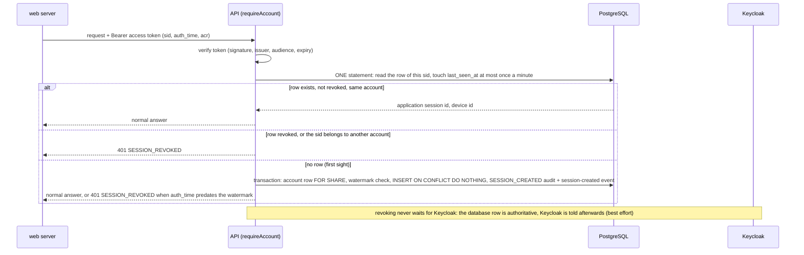

# Sessions, second factor and recovery

ID-004 gives a signed-in person control over where they are signed in and how they prove it is them: a registry of the application sessions and browsers of the account, "sign out everywhere" that takes effect at once, a second factor (authenticator app) with recovery codes, a step-up protocol for sensitive actions, a password reset that is started by BananaGig, and a security timeline. Keycloak remains the authority for passwords, TOTP, recovery codes and protocol sessions; BananaGig owns the registry, the revocation state and the timeline and only ASKS Keycloak (through a dedicated service account). Decisions: ADR-0034 (application session registry, revocation and the timeline), ADR-0035 (the Keycloak security admin client and the `SecurityIdentityProvider` port), ADR-0036 (step-up, MFA ownership and the trusted browser). Baselines: ADR-0013 (Keycloak is the identity provider), ADR-0014 (server-side web session), ADR-0025 (account versus Keycloak identity), ADR-0029 (rate limits).

Requirements served: CU-09.20 (active sessions and browsers with Sign out per session and Sign out everywhere, and a security activity log for the configured period; the approximate location is NOT built, DEBT-0074), the acceptance criterion "Sign out everywhere ends all other sessions within one minute", SV-01.12 ("Keep me signed in" lasts 30 days, users can sign out of all browsers), CU-09.12 (other sessions are signed out when the password changes; the notice email is NOT built, DEBT-0068), CU-09.13 (authenticator app and recovery codes; a trusted browser is recorded; the email and SMS one-time-code factors are NOT built, DEBT-0067), CU-09.14 (the step-up primitive exists; the callers are not wired, DEBT-0050 and DEBT-0062), CU-03.11 (single-use reset link valid 60 minutes, five failed attempts in 15 minutes lock the account for 15 minutes) and the first half of CU-03.12 (reset by email link; the phone confirmation and the support route are NOT built, DEBT-0067).

## Scope

In scope: migration 0012 (two tables, the watermark column, the wider audit action list, six configuration parameters, 86 managed content entries), `SecurityService` (`packages/accounts/src/security-service.ts`), the Keycloak admin client (`packages/identity/src/keycloak-admin.ts`), the step-up guards, thirteen API operations (twelve authenticated, one public), the web pages `/security` and `/forgot-password` with their BFF handlers, the realm changes (web browser flow, MFA floor, service account, closed built-in surface), the Caddy block and the tests.

Out of scope (nothing exists for any of these): an email or SMS one-time code as second factor, WebAuthn (DEBT-0018), a step-up for accounts with no TOTP, the phone confirmation after a reset, the lost-both-channels support route (DEBT-0067), consuming Keycloak events (DEBT-0068), a password-changed email notice, an approximate location for sessions, an admin security console (DEBT-0074), a trusted browser that changes Keycloak's behaviour (DEBT-0066), account closure that revokes sessions (DEBT-0074).

## Ownership

| Question | Keycloak | BananaGig |
|---|---|---|
| Passwords, the password policy, brute-force lock-out | owns (`length(12) and notUsername`, 5 failures in 15 minutes lock 15 minutes) | never sees or stores a password |
| TOTP secret, recovery codes (`recovery-authn-codes` credential) | owns; creates, verifies and consumes them | stores NO secret and NO code. Reads only whether the credential kinds exist (`getUserSecurity`) |
| Protocol sessions, refresh tokens, SSO cookie, `sid` | owns | keeps a registry row per `sid` the API has seen (`identity.application_sessions`); never a token |
| Which authentication happened (`auth_time`, `acr`) | issues the claims | reads them from the VERIFIED access token only |
| When Keycloak asks for a code | owns (flow `bananagig-browser`, floor `minimum.acr.value`) | cannot change it per browser (see "Devices and the trusted browser") |
| Application sessions, revocation, "sign out everywhere" | ends the protocol session when asked | owns the revocation state and enforces it on every request |
| Browsers (devices), the trusted-browser window | knows nothing about them | owns (`identity.account_devices`) |
| The security timeline | emits events nobody consumes yet (DEBT-0068) | owns, as a read model over `identity.account_audit_events` |
| The password reset link | creates, signs, emails and consumes it | decides WHO may ask (public endpoint, rate limits, verified address only) and records the request |
| The realm configuration | the file `infra/keycloak/bananagig-realm.json` (the only source), linted by `scripts/lib/realm.mjs` | |

## How a request is enforced

Every API request that goes through `requireAccount()` (`apps/api/src/plugins/account.ts`) resolves the verified token's `sid` to an application session when the security layer is wired:



- **A token without `sid` is `401 INVALID_TOKEN`** (with the Bearer `invalid_token` challenge). `sid` comes from the verified token and nowhere else.
- **`SESSION_REVOKED`** is `401`, category AUTHENTICATION, code `SESSION_REVOKED` (not prefixed `ACCOUNT_`), `WWW-Authenticate: Bearer realm="<realm>", error="invalid_token"`, `details.messageKey` `account.security.error.session_revoked`. It is returned for a revoked row, for a row that belongs to ANOTHER account (never leak, never reassign a `sid`) and for a first-seen session refused by the watermark.
- **Why "within one minute" holds although access tokens live 300 seconds.** The access token is only a bearer of identity; whether a session is still allowed is decided by the database on EVERY request, not by the token's expiry. A revoked session is therefore refused on its very next request (the integration tests measure well under one second, also for a Keycloak session the API had never seen). The web server notices at its next API call: it deletes its Valkey session, clears the cookie and sends the browser through Keycloak's end-session endpoint. Ending the Keycloak session (so the refresh token stops working and the SSO cookie cannot sign the browser in again silently) is best effort and not what the guarantee rests on. The guarantee covers every route behind `requireAccount()`; routes that use only `requireAuthenticated()` (for example `GET /system/whoami`) still accept a revoked session's token until it expires (DEBT-0074).
- **The touch.** `last_seen_at` moves at most once per 60 seconds (the update is a heap-only-tuple update: the table has fillfactor 80 and no index on `last_seen_at`). A revoked row is refused whatever its `last_seen_at`.
- **The watermark `identity.accounts.sessions_not_before`.** Revoke-all raises it to the database clock. It matters only for a session FIRST SEEN after it (a Keycloak session that existed but the API had not seen): such a session is refused when its `auth_time` is missing or more than two seconds older than the watermark. Within the two-second clock-skew window on either side, the service accepts it only when Keycloak's whole-second session start time is at least one full second newer than the watermark; this conservative margin rejects starts that could precede the watermark within the reported second. Unavailable or inconclusive provider data is refused. Clearly newer `auth_time` values remain accepted. A session that already has a row is governed by its own `revoked_at`. The Keycloak lookup happens before first sight takes the account row `FOR SHARE`, while revoke-all takes it `FOR UPDATE`; revoke-all never waits for Keycloak and the database operations serialize, so either the new row exists when revoke-all runs (and is revoked) or first sight reads the raised watermark. A trigger keeps the watermark monotonic, never NULL again and never more than a minute in the future; a CLOSED account stays immutable, so the service does not raise it for one.
- **Active or ended is DERIVED**, never stored: ACTIVE is `revoked_at IS NULL` within the `session.keep_signed_in_days` window and still known to Keycloak when it can be asked. The listing closes rows older than the window (reason `KEYCLOAK_ENDED`, audit `SESSION_ENDED` with `expired: true`) and reconciles the rest with Keycloak's own session list (rows younger than 15 seconds are never ended, the cutoff is taken before Keycloak is asked; the current session is never ended; a Keycloak failure mutates nothing and the answer says `reconciled: false`). The listing also retries the Keycloak propagation of earlier revocations that Keycloak still lists (at most 20 per call).
- **Revocation reasons** (`SESSION_REVOCATION_REASONS`): `SIGN_OUT`, `REVOKED_BY_USER`, `SIGN_OUT_EVERYWHERE`, `KEYCLOAK_ENDED`, `DEVICE_REMOVED`, `PASSWORD_CHANGED`. The status shown to the owner is derived from the reason (`ENDED` for `SIGN_OUT` and `KEYCLOAK_ENDED`, `REVOKED` for the others). Revocation is terminal (trigger).
- **Propagation to Keycloak** runs AFTER the commit, holds no lock and never undoes the revocation. The result reports `keycloak`: `ENDED`, `UNAVAILABLE` or `NOT_NEEDED`. Revoke-all with `includeCurrent` false lists Keycloak's sessions and ends each except the current one; with `includeCurrent` true it ends them all (`POST users/{id}/logout`).
- **Lock order** everywhere: the account row (`FOR UPDATE`), then the device row, then the session rows. The only paths that skip the account `FOR UPDATE` are the request-path touch (one statement, waits for nothing) and first sight (`FOR SHARE`).

## Data model

Migration `0012_application_sessions.sql` (forward-only, one transaction; the full review is in `docs/data/DATA_MODEL.md` and `NORMALIZATION_LOG.md`):

- `identity.application_sessions`: `application_session_id` (the handle the API hands out), `account_id`, `keycloak_session_id` (the `sid`: unique, 1 to 100 visible characters, NEVER logged, returned, audited or put in an event), `account_device_id` (set once, composite foreign key with the account), `created_at`, `last_seen_at`, `revoked_at` and `revocation_reason` (set together, terminal). Guard trigger rule keys: `NOT_DELETABLE`, `SESSION_IMMUTABLE`, `SESSION_REVOKED_TERMINAL`, `SESSION_DEVICE_IMMUTABLE`, `SESSION_LAST_SEEN_MONOTONIC`, `ACCOUNT_CLOSED`, `DEVICE_REMOVED_TERMINAL`.
- `identity.account_devices`: `device_hash` (hex HMAC), the three coarse families, `first_seen_at`, `last_seen_at`, `trusted_at` and `trusted_until` (set and cleared together), `removed_at` (terminal, never trusted). Guard rule keys: `NOT_DELETABLE`, `DEVICE_IMMUTABLE`, `DEVICE_LAST_SEEN_MONOTONIC`, `DEVICE_REMOVED_TERMINAL`, `ACCOUNT_CLOSED`.
- `identity.accounts.sessions_not_before` (the watermark; rule key `SESSIONS_WATERMARK`).
- `identity.account_audit_events` gains `application_session_id` and `account_device_id` (composite foreign keys with the account, so an audit row can only name a session or device of the audited account), the action list is widened with the sixteen security actions, and two checks tie the `SESSION_` and `DEVICE_` prefixes to the references (`SESSIONS_REVOKED_ALL` does not match `SESSION\_%`).
- Indexes: `idx_application_sessions__account_live (account_id) WHERE revoked_at IS NULL` serves the list, revoke-all, the expiry close and the reconciliation. It is deliberately NOT keyed on `last_seen_at` (the original design had `(account_id, last_seen_at DESC)`): an indexed column would turn the once-a-minute touch into a non-HOT update; the few live rows of an account are sorted in memory. `idx_application_sessions__device` serves device removal; `idx_account_audit_events__account_security_state` (partial, nine observed actions) serves the observation of transitions.

## Devices and the trusted browser

A device is a BROWSER of an account, recognised by a cookie the web server issues:

| Item | Contract |
|---|---|
| Cookie | `bg_device` (`__Host-bg_device` on https), HttpOnly, SameSite=Lax, Path=/, no Domain, Secure on https, Max-Age 400 days (a technical ceiling, not a business value). Value: 43 base64url characters (32 random bytes). Minted by `ensureDeviceSecret` (`apps/web/src/lib/auth/device.ts`) and renewed at every login; a malformed value is replaced, never trusted |
| Transport | sent ONCE per login in the body of `POST /account/security/sessions/current` `{device, userAgent?}` by `handleCallback`, best effort (2 seconds; a failure is logged and the login still succeeds). Never in Valkey, the session record, a URL, a redirect or a log |
| Stored | `HMAC-SHA-256(VERIFICATION_HASH_SECRET, 'bananagig:device:v1', account_id, secret)` as 64 hex characters (length-prefixed, domain separated like `verification-crypto.ts`). The account id is part of the hash, so one browser has a different hash on each account and a database leak yields no usable cookie |
| User agent | reduced by `classifyUserAgent` to three closed families (browser CHROME/FIREFOX/SAFARI/EDGE/OPERA/OTHER, system WINDOWS/MACOS/LINUX/IOS/ANDROID/OTHER, class DESKTOP/MOBILE/TABLET/OTHER) and discarded. At most 512 characters are looked at. No raw IP address, no location |
| Registration | idempotent. The FIRST device of a session wins; presenting another secret later changes nothing and creates no row ("ghost devices"). A removed device is terminal: the same cookie yields `deviceId: null` and the web server mints a fresh secret and registers once more (`handleCallback`); removing the current browser from `/security` clears the cookie |
| Removing a browser | untrusts it, marks it removed and revokes ITS sessions with reason `DEVICE_REMOVED` (the caller's own session included when it is that browser) |

**The trusted browser is recorded, shown and expires. It does NOT change when Keycloak asks for a code.** `POST /account/security/devices/current/trust` (needs a recent authentication) sets `trusted_until` to now plus `session.trusted_browser_days` (default 30, PRD CU-09.13); trusting a trusted browser extends the window; untrusting, removing the browser or letting the clock pass ends it (`trusted = trusted_until > clock_timestamp() AND removed_at IS NULL`, evaluated by the reader, no sweeper). The flag is shown on the sessions, browsers and overview, and it never satisfies a step-up guard. The managed copy `account.security.devices.trust_note` says plainly that the sign-in service still decides when it asks for a code, and the API summaries of the trust operations say the same.

Why it has no login-time effect: Keycloak cannot skip the OTP step for one browser without a custom extension (an authenticator SPI). The tempting shortcuts do not work: `acr_values` and the essential `claims` parameter travel through the browser, so they are tamperable and, as the lab showed, Keycloak ignores `acr_values` for users without a factor and does not enforce an essential `claims` acr for them; `max_age` and `prompt` can only ask for MORE authentication. What does exist is Keycloak's own session: with "Keep me signed in" the SSO session lives 30 days and the MFA level is remembered for the same period (`loa-max-age` 2592000), so a remembered browser is not asked for a code again while its SSO session lives. That is a Keycloak session property, independent of BananaGig's trusted flag.

Preferred future design (DEBT-0066, not built): either (a) an offline-session-backed trusted browser, where trusting a browser makes Keycloak keep a long-lived session for that browser and the trusted window is the session lifetime, or (b) a signed request object (RFC 9101) in which BananaGig tells Keycloak, tamper-proof, that this device is trusted, consumed by a custom authenticator in the flow that may then skip the OTP step. Both need a decision and a Keycloak extension or session design; neither may make a trusted browser satisfy a step-up guard.

## The Keycloak flow

Defined in `infra/keycloak/bananagig-realm.json`, bound ONLY to `bananagig-web` (`authenticationFlowBindingOverrides.browser`); the realm's `browser` flow and the admin client's own flow are untouched.

```text
bananagig-browser
  Cookie                                  ALTERNATIVE
  bananagig-browser-forms                 ALTERNATIVE
    Username Password Form                REQUIRED
    bananagig-browser-mfa                 CONDITIONAL
      Condition: Level of Authentication  REQUIRED   (level 2, max age 2592000 s)
      Condition: User Configured          REQUIRED
      OTP Form                            ALTERNATIVE
      Recovery Authentication Code Form   ALTERNATIVE
```

- **The floor.** The client attribute `minimum.acr.value=bananagig:mfa` (with `acr.loa.map` `bananagig:password`=1, `bananagig:mfa`=2) makes level 2 the minimum for EVERY authorization request of the web client whatever its URL says. Without the floor a request without `acr_values` would skip the second factor (the level-2 condition is false when nothing asks for level 2). The User Configured condition then skips the step for users who have no factor. Enforcement is therefore intrinsic to the flow and does not depend on the browser sending anything; the API reads the `acr` claim of the verified token.
- **Users without a factor** get password only and an access token with `acr=bananagig:password`. Asking for `acr_values=bananagig:mfa` is ignored (no error, no forced enrolment); an essential `claims` acr is not enforced for them either. Those users get `403 MFA_ENROLLMENT_REQUIRED` from `requireMfa()` and the web reports `step_up_required` after a requested MFA login.
- **Password-only users re-enter their password on each authorization request**: the SSO cookie of a level-1 session is below the floor, so the next authorization request (a new login, a step-up, a `kc_action`) asks for the password again (same `sid`, no error), and `prompt=none` returns `login_required`. Users with an OTP credential keep their SSO. This is the cost of the floor and is accepted (DEBT-0074). Do not gate the password form by level: it makes password-only users fail with "Invalid username or password" on SSO re-entry (lab).
- **The factors are flat siblings.** Nesting them in a sub-flow under the User Configured condition breaks every login (lab). Do not restructure the flow without the lab scripts.
- **Recovery codes** are Keycloak's own `recovery-authn-codes` credential. The user is asked for a NUMBERED code ("Recovery code #3"), only the next one in sequence works, each is single use, upper case, 12 characters, and generating a new set replaces the old one. Admin REST cannot create them: they are enrolled through `kc_action=CONFIGURE_RECOVERY_AUTHN_CODES`. The API can read the credential's `remainingCodes` count; it is not surfaced (DEBT-0074).
- **Brute force** (PRD CU-03.11): `bruteForceProtected`, `permanentLockout` false, `failureFactor` 5, `maxDeltaTimeSeconds` 900, `waitIncrementSeconds` 900, `maxFailureWaitSeconds` 900. The sixth attempt with the CORRECT password is refused with the same generic message (no lock oracle); wrong OTP codes count. Anyone who knows an address can lock that user for 15 minutes; that is PRD-mandated (DEBT-0073).
- **Keep me signed in** (PRD SV-01.12): `rememberMe` true, `ssoSessionIdleTimeoutRememberMe` and `ssoSessionMaxLifespanRememberMe` 2592000 (30 days). Without the box: idle 1800 s, max 36000 s, session cookie. The configuration parameter `session.keep_signed_in_days` (default 30) must equal the realm value; a test compares the two (DEBT-0070).
- **Refresh tokens rotate**: `revokeRefreshToken` true, `refreshTokenMaxReuse` 1. With 0 a second use of a token kills the whole chain and two racing refreshes lose a request in most trials; with 1 one reuse of the just-used token is tolerated and two concurrent refreshes both succeeded. The web server adds a SINGLE-FLIGHT refresh per session id in `getSession` (concurrent requests of one browser share one refresh); it is per process (DEBT-0069).
- **The reset link has a "log out other sessions" checkbox, unchecked by default** in Keycloak 26.3.5, and there is no native "sign out other devices on password change" default. BananaGig therefore revokes the older sessions itself when it observes the change (see "Password reset").

## Step-up

`apps/api/src/plugins/step-up.ts`. The guards read ONLY the claims of the verified token (`auth_time`, `acr`): never a header, body, cookie or the trusted-browser flag.

| Guard | Passes when | Otherwise |
|---|---|---|
| `requireRecentAuthentication()` | `auth_time` is within `security.step_up_valid_minutes` (default 15) and not more than 60 s in the future | `401 STEP_UP_REQUIRED`, requirement `RECENT_AUTHENTICATION` |
| `requireMfa()` | `acr` is `bananagig:mfa` AND `auth_time` is within the window | if `acr` is not MFA: the person has no TOTP -> `403 MFA_ENROLLMENT_REQUIRED`; the identity provider cannot be asked -> `503 ACCOUNT_SECURITY_UNAVAILABLE` (fail closed); has TOTP -> `401 STEP_UP_REQUIRED`, requirement `MFA`. If `acr` is MFA but old: `401 STEP_UP_REQUIRED` |
| `requireStepUp(requirement)` | dispatches by `StepUpRequirement` | |

- **Guard order.** `preValidation: [requireAccount(), <step-up guard>, strictBody(...)]`: authentication and the session check (401, 403) win over the step-up (401), which wins over the body check (400). The guards authenticate and require the web context themselves; `requireMfa()` needs `request.account`, so it must follow `requireAccount()` (it throws a programming error otherwise).
- **Wired today:** `POST /account/security/devices/current/trust` and `POST /account/security/mfa/enrollment` use `requireRecentAuthentication()`. `requireMfa()` and `requireStepUp()` exist and are unit tested but NO route uses them yet. The step-up is NOT wired into `POST /account/email` or `POST /account/phone` (DEBT-0050, DEBT-0062).
- **Response shape (RFC 9470).** `401`, category AUTHENTICATION, code `STEP_UP_REQUIRED`, `details` = `{ requirement, maxAgeSeconds, acrValues?, messageKey }` (`account.security.error.step_up_required`), and `WWW-Authenticate: Bearer realm="<realm>", error="insufficient_user_authentication", error_description="A more recent or stronger authentication is required", max_age="<seconds>"` plus `, acr_values="bananagig:mfa"` for the MFA requirement. `MFA_ENROLLMENT_REQUIRED` is `403`, category AUTHORIZATION, `details.messageKey` `account.security.error.mfa_enrollment_required`. The window is read from configuration on every request, so a change applies at once; an unreadable configuration is a `503`.
- **How the web reacts** (`handleSecurityAction`). A `401 STEP_UP_REQUIRED` becomes ONE login round trip: `303 /auth/login?returnTo=/security&stepUp=recent|mfa`. `handleLogin` maps `recent` to `prompt=login`, `mfa` to `prompt=login` plus `acr_values=bananagig:mfa`, and records the step-up in the login transaction (`stepUp: {level, startedAt}`). Coming back does NOT repeat the action: the person submits it again. The callback checks that the step-up was really reached by reading the VERIFIED token (`auth_time` not older than the start of the round trip minus 10 s; for `mfa`, `acr` is MFA); when it was not (Keycloak ignored the parameters) it returns to the page with `error=step_up_required` and starts NO second round trip. That transaction field is the one-shot marker that prevents a loop.
- **Never trust `acr_values` from the browser.** `/auth/login` accepts `stepUp` and `kcAction` query values from closed lists only; anything else is ignored, never forwarded (`buildAuthorizeUrl` also refuses values outside its whitelists: `prompt` only `login`, `max_age` an integer 0 to 86400, `acr_values` the two realm values, `kc_action` the two actions). The browser can drop any authorization parameter, so the real requirement is enforced by the flow's floor and by the API reading the token, not by what the URL asked for.

## Enrolling a second factor

Keycloak creates and shows the secret and the codes; BananaGig never sees them. The bridge uses Keycloak's application-initiated actions (`kc_action`):

1. `/security` posts a form to `POST /auth/security/mfa-enroll` (`method` = `TOTP` or `RECOVERY_CODES`; Origin check, session required, exactly that field). The web server calls `POST /account/security/mfa/enrollment`, which needs a recent authentication (otherwise the step-up round trip above), audits `MFA_ENROLLMENT_REQUESTED` or `RECOVERY_CODES_REQUESTED` and returns `{method, keycloakAction}` (`CONFIGURE_TOTP` or `CONFIGURE_RECOVERY_AUTHN_CODES`).
2. The web server cross-checks the answer against its own constant, stores the ONE-SHOT enrollment marker (Valkey key `bg:<env>:web:enroll:<browser session id>`, 300 seconds) and redirects to `/auth/login?returnTo=/security&kcAction=totp|recovery`.
3. `handleLogin` honours `kcAction` only if it can take (read and delete, atomically) that marker for the browser's session and its method matches; no session, no marker, an expired or used one, or another method means the parameter is ignored and a plain login starts. A `kc_action` therefore always follows an accepted, step-up-checked request. It forces `prompt=login` (the callback verifies it) and sends `kc_action=<action>`.
4. Keycloak authenticates again and shows the credential page; the outcome returns to `/auth/callback?...&kc_action_status=success|cancelled|error`. The callback adds the whitelisted word to the return URL as `kc_action_status`.
5. `/security` shows the success notice only when the overview proves a factor IS configured (the words in the URL can be typed by anyone); `cancelled` claims nothing and is shown as is.

Observed transitions: BananaGig is not told when a factor changes, so it observes. `getOverview` and the registration at login read Keycloak's credential kinds and compare them with the LAST such audit action of the account, under the account lock, idempotently (two concurrent observers write once): `MFA_ENABLED`, `MFA_DISABLED`, `RECOVERY_CODES_ENABLED`, `RECOVERY_CODES_DISABLED` (with the `mfa-enabled` and `mfa-disabled` events). A factor that is already configured the FIRST time it is seen, with no enrolment request audited before, is a BASELINE (state that pre-dates the audit trail): it is anchored with `changes.baseline = true`, no event, and is not shown on the timeline. Consequences: the audit time of a transition is the time of observation, not of the change (DEBT-0074); `hasMfaEnrolled` looks at TOTP only (recovery codes alone do not satisfy it); a Keycloak failure makes the overview report `mfa.available: false` (the flags then mean "unknown").

A support reset of a factor is `DELETE users/{id}/credentials/{credId}` with the service account (verified in the lab); the realm disables the self-service route (`delete_credential`, below).

## Password reset

The built-in "Forgot password" is off (`resetPasswordAllowed` false and Caddy refuses `/realms/bananagig/login-actions/reset-credentials`), so every reset is started by BananaGig, where it can be rate limited and recorded. The `/session` page links to `/forgot-password`.

- **Public endpoint** `POST /api/v1/auth/password-reset` `{email}` (strict body, 2 KB limit, `security: []`). The answer is ALWAYS `202 {data: {accepted: true}}`, whether the address is unknown, invalid, unverified, closed, or the work failed. The web page `/forgot-password` posts to `POST /auth/password-reset` (Origin check) and always redirects to `?status=accepted` for a 202; only `429` (`rate_limited`), a `400` (`invalid`) or a failure (`unavailable`) show anything else, and those depend on the caller, not on the account.
- **Rate limits** (reusable limiter, ADR-0029): buckets `password-reset:email` (key `hashDimension(secret, 'email', canonical address)`; for an address that cannot be canonical, the hash of what was sent) and `password-reset:ip` (`hashDimension(secret, 'ip', request.ip)`), each `reset_link.max_requests_per_hour` per hour. A refusal is `429 ACCOUNT_PASSWORD_RESET_RATE_LIMITED` with `Retry-After` and never names the dimension. The limiter fails CLOSED (`503 ACCOUNT_UNAVAILABLE`, reason `RATE_LIMITER_UNAVAILABLE`) because each request can send an email. The source address is only as good as `TRUSTED_PROXY_HOPS` (ADR-0033): with a wrong hop count the per-source bucket is shared by everyone or chosen by the client (DEBT-0073).
- **Uniform timing.** What the caller waits for is identical for known, unknown and invalid addresses: the policy read, the hashing and the Valkey consumption. Everything that depends on the address belonging to an account runs DETACHED (`void promise.catch(log)`): the lookup of the account by the canonical VERIFIED primary email contact (CLOSED accounts excluded), the audit, and the Keycloak calls. A failure logs a code only (never the address, subject or link). `drain()` waits for the detached work at shutdown (bounded to 5 seconds).
- **Only to Keycloak's own address.** The service records `PASSWORD_RESET_REQUESTED` (audit and `password-reset-requested` event), then reads the user from Keycloak and sends ONLY if Keycloak's address equals the canonical verified one (case-insensitive); otherwise nothing is sent. The audit row therefore means "requested", not "sent". The email is sent by Keycloak (`execute-actions-email`, `UPDATE_PASSWORD`, `lifespan` = `reset_link.validity_minutes * 60`, with the web client id and the redirect URI `<WEB_PUBLIC_URL>/session` so the page after the reset can link back). Keycloak sends from `smtpServer.from` to the user's address only (no Cc or Bcc); in development the SMTP server is Mailpit.
- **After the link.** The link opens an interstitial, then Keycloak's UPDATE_PASSWORD form (with the unchecked "sign out of other sessions" box); once used, the same link says the action expired. The person is NOT logged in afterwards (even with OTP): the info page links to the bare redirect URI, which `/session` tolerates.
- **Sessions after a change.** Keycloak 26.3.5 has no native default to end other sessions on a password change, so BananaGig does: when it OBSERVES a newer password credential (`passwordChangedAt`, at the next overview or login registration) it audits `PASSWORD_CHANGED`, or `PASSWORD_RESET_COMPLETED` (and the `password-reset-completed` event) when a `PASSWORD_RESET_REQUESTED` is newer than the last password audit and the change falls within the link lifetime plus 5 minutes after it, and revokes every OTHER live session that started before the new password with reason `PASSWORD_CHANGED` (the current session is kept, the watermark is not touched), then ends them in Keycloak after the commit. The password that existed when the account was created is not "a change". Until the owner next logs in or opens `/security`, another session of the same user keeps working (DEBT-0068).

## The security timeline

A read model over `identity.account_audit_events`; there is no separate activity table. `GET /account/security/activity?limit=&before=` returns, newest first, the events of the last `security.activity_log_days` (default 90) whose action is one of the 20 activity types (the 16 security actions plus `EMAIL_VERIFIED`, `EMAIL_PRIMARY_CHANGED`, `PHONE_VERIFIED`, `PHONE_PRIMARY_CHANGED`), baseline rows excluded. `limit` is an integer 1 to 100 (default 25, checked lexically); `before` is an ISO 8601 instant with an offset (the `nextBefore` of the previous page, a microsecond timestamp). Each entry has the type, the time, `labelContentKey` (`account.security.activity.<type>`), the application session id when it concerns one and the COARSE device of that session; `outcome` is always `SUCCESS` today. Rows that share a microsecond across a page boundary could be skipped (accepted). Wrong verification codes and similar are not on the timeline.

## The Keycloak service account

`bananagig-security` (`packages/identity/src/keycloak-admin.ts`) lets the API ask Keycloak and end sessions:

| Item | Value |
|---|---|
| Client | confidential, `client-secret` authentication, service account on; standard, implicit and direct-access flows OFF (a password grant and a browser flow fail), no redirect URI, no web origin, no bound browser flow, `fullScopeAllowed` false, default scope `roles` (without it the token has no `resource_access` and every call is 403), access token 120 s, no refresh token |
| Roles | the service-account user `service-account-bananagig-security` holds `realm-management` `manage-users` and nothing else; the same role is scope-mapped to the client. The linter requires exactly this |
| Calls (all) | token (client credentials, cached until 30 s before expiry, one in-flight refresh), `GET users/{id}`, `GET users/{id}/credentials`, `GET users/{id}/sessions`, `DELETE sessions/{sid}` (404 is success), `POST users/{id}/logout`, `PUT users/{id}/execute-actions-email` |
| Transport | `fetch`, 5 s timeout, no retry, no redirect following, ids percent-encoded. Every failure is reduced to a CODE (`UNREACHABLE`, `TIMEOUT`, `TOKEN_REJECTED`, `FORBIDDEN`, ...); never a response body, token, secret, URL or id |

**Why `manage-users`.** The lab measured it: reading credentials, sessions and the user (including the email) works with `view-users`; ending one session, ending all sessions of a user and `execute-actions-email` return 403 for anything below `manage-users`. `query-users` only adds user search. `manage-users` is the minimum for the operations this client performs.

**Blast radius.** `manage-users` is realm-wide user administration: whoever holds the secret can create, change and delete any user, set credentials, end any session and send required-action emails for any user. It cannot change realm settings or clients (no `manage-realm`, `manage-clients`). Fine-grained admin permissions (restricting the role to specific users or operations) are a Keycloak feature disabled in this stack (`ADMIN_FINE_GRAINED_AUTHZ` needs a `--features` change) and were not tried (DEBT-0071). Containment: only the API process holds the secret; the client can neither log anyone in nor take a password grant; the linter forbids any other client from enabling a service account and any other role on this one; the API's use is limited to the five calls above.

**Secret handling.** `KEYCLOAK_SECURITY_CLIENT_ID` (default `bananagig-security`) and `KEYCLOAK_SECURITY_CLIENT_SECRET` (32 to 256 characters). Development: the placeholder `bananagig_security_dev_only_secret_0001` is in `.env.example`, in `packages/config` as the development default and in the realm file; a test checks that the realm value equals the configuration default. Production: the API role REQUIRES the secret and refuses the development value at startup; `pnpm identity:build-prod` strips the secret from the client (Keycloak then generates one, readable at `GET clients/{id}/client-secret` and rotated by `POST` there), keeps the service-account user (dropping it would drop its role mapping and Keycloak would recreate it without roles) and removes the development SMTP server. Provisioning the real secret and the production SMTP server is a deployment task (DEBT-0016, DEBT-0071); `${ENV}` placeholders in realm import files were not verified. The secret is masked by `redactConfig` and appears in no log. If the secret is wrong or the client is missing (for example the dev realm was not re-imported), every call fails with `TOKEN_REJECTED`: the overview reports `mfa.available: false`, revocation propagation says `UNAVAILABLE`, and no reset email is sent, all without breaking the application revocation.

## Realm changes that closed holes

The built-in surface of Keycloak let a signed-in user manage credentials and sessions outside BananaGig (no step-up, no audit, no registry):

- The built-in clients `account` and `account-console` are declared `enabled: false` (an undeclared one is created enabled by the import). The account console is gone for users (DEBT-0019 keeps the login theme).
- `requiredActions` is declared EXPLICITLY. A realm file that declares a partial list REPLACES Keycloak's defaults, so the product ones are listed and enabled (`CONFIGURE_TOTP`, `CONFIGURE_RECOVERY_AUTHN_CODES`, `UPDATE_PASSWORD`, plus the usual `UPDATE_PROFILE`, `VERIFY_EMAIL`, `VERIFY_PROFILE`, `update_user_locale`) and `delete_credential`, `webauthn-register`, `webauthn-register-passwordless` and `idp_link` are disabled: any client can start `kc_action=delete_credential` for a signed-in user and remove the second factor unseen by BananaGig. They are re-enabled when the feature that uses them is built (WebAuthn: DEBT-0018).
- Caddy (`infra/caddy/Caddyfile`) returns 404 for `/realms/bananagig/account*` and `/realms/bananagig/login-actions/reset-credentials*` BEFORE the wholesale realm proxy. The action-token path that the reset email uses (`/login-actions/action-token`) stays open.
- The web client registers exactly `http://app.localhost:8080/session` (the reset return) as a redirect URI and `...?error=session_revoked` as a post-logout URI.

`scripts/lib/realm.mjs` lints all of it (`pnpm identity:check`, unit tests, CI): the single allowed service account and its exact roles, the flow and the MFA floor consistent with `acr.loa.map`, the flow not shared with the admin client, the built-in clients disabled, the required actions declared, brute-force, remember-me, rotation and `resetPasswordAllowed=false` values, the development SMTP server absent from a production realm, and only service-account users in a production realm.

**Operational note.** `--import-realm` skips a realm that already exists, so a running dev stack gets these changes only through `pnpm identity:sync` (or `pnpm stack:reset`). `identity:sync` deletes and recreates the realm: the development users get NEW subjects and therefore NEW, empty BananaGig accounts on their next login (the old accounts stay, unlinked), and every session is lost. Until it is run, the `bananagig-security` client does not exist and the security layer reports Keycloak as unavailable.

## Configuration

Six CFG-001 parameters (migration 0012; `SECOND_APPROVER`, CRITICAL, owner security, PLATFORM scope, never cached, read fresh, no code default: an invalid or missing value fails the operation closed with `ACCOUNT_UNAVAILABLE`, reason `POLICY_UNAVAILABLE`):

| Key | Range | Default | Source |
|---|---|---|---|
| `session.trusted_browser_days` | 1 to 365 | 30 | PRD CU-09.13 |
| `session.keep_signed_in_days` | 1 to 90 | 30 | PRD SV-01.12; MUST equal the realm remember-me lifetimes |
| `reset_link.validity_minutes` | 5 to 1440 | 60 | PRD CU-03.11 |
| `security.step_up_valid_minutes` | 1 to 60 | 15 | engineering ASSUMPTION |
| `security.activity_log_days` | 30 to 730 | 90 | engineering ASSUMPTION (PRD CU-09.20 says "the configured period") |
| `reset_link.max_requests_per_hour` | 1 to 20 | 5 | engineering ASSUMPTION |

The three assumptions and the duplicated remember-me value are DEBT-0070. The consumer (`createSecurityPolicyProvider`, `apps/api/src/modules/security/wiring.ts`) re-validates every value with the same bounds (`parseSecurityPolicy`).

## API

Under `/api/v1`. Every route except the last runs behind `requireAccount()` (web identity context, ACTIVE account; a SUSPENDED or CLOSED account is a 403 before any session logic), acts on the account and session of the verified token, accepts NO account id, subject, Keycloak session id or role (path ids are application ids of the caller's own account; a foreign id is a 404 indistinguishable from an unknown one), validates bodies raw and strictly and path parameters as strict UUIDs before Ajv, and answers `Cache-Control: no-store` including errors.

| Operation (`operationId`) | Method and path | Guards | Notes and errors |
|---|---|---|---|
| `registerAccountSecuritySession` | POST `/account/security/sessions/current` `{device, userAgent?}` | account | idempotent; first device wins; 401 `SESSION_REVOKED` for a revoked session |
| `getAccountSecurity` | GET `/account/security` | account | MFA state (`available`, `totpConfigured`, `recoveryCodesConfigured`), step-up state, current session and browser, policy windows |
| `listAccountSecuritySessions` | GET `/account/security/sessions` | account | current first, then by last activity; `reconciled` |
| `revokeAccountSecuritySession` | DELETE `/account/security/sessions/{sessionId}` | account | idempotent (`changed`); `keycloak` outcome; 404 `ACCOUNT_SESSION_NOT_FOUND`; revoking the current session is allowed |
| `revokeAllAccountSecuritySessions` | POST `/account/security/sessions/revoke-all` `{includeCurrent?}` | account | default false; raises the watermark; `revokedCount`, `keycloak` |
| `signOutCurrentAccountSecuritySession` | POST `/account/security/sessions/current/sign-out` (no body) | account | reason `SIGN_OUT`; repeating it is a 401 `SESSION_REVOKED`; needs no configuration |
| `listAccountSecurityDevices` | GET `/account/security/devices` | account | removed browsers are not listed |
| `trustCurrentAccountSecurityDevice` | POST `/account/security/devices/current/trust` (no body) | account, `requireRecentAuthentication()` | 401 `STEP_UP_REQUIRED`; 409 `ACCOUNT_DEVICE_REQUIRED`; no effect on Keycloak |
| `untrustCurrentAccountSecurityDevice` | DELETE `/account/security/devices/current/trust` | account | idempotent, no step-up; 409 `ACCOUNT_DEVICE_REQUIRED` |
| `removeAccountSecurityDevice` | DELETE `/account/security/devices/{deviceId}` | account | idempotent; revokes the browser's sessions; 404 `ACCOUNT_DEVICE_NOT_FOUND` |
| `listAccountSecurityActivity` | GET `/account/security/activity?limit=&before=` | account | strict query |
| `startAccountSecurityMfaEnrollment` | POST `/account/security/mfa/enrollment` `{method}` | account, `requireRecentAuthentication()` | returns `{method, keycloakAction}`; no secret |
| `requestPasswordReset` | POST `/auth/password-reset` `{email}` | none (public) | always `202`; `429 ACCOUNT_PASSWORD_RESET_RATE_LIMITED`; `503 ACCOUNT_UNAVAILABLE` |

Other codes: `ACCOUNT_SECURITY_UNAVAILABLE` (503, DEPENDENCY, retryable) when a guard cannot ask Keycloak; `ACCOUNT_UNAVAILABLE` (503) when PostgreSQL or the policy cannot answer. Every code carries `details.messageKey` (`account.security.error.<code>`). The email and phone routes now pass the session's device id to their limiter, so the per-device dimension finally has an identifier (DEBT-0054).

## Events and audit

Transactional outbox, aggregate `identity_account`, identifiers only (never a `sid`, token, address or secret): `bananagig.identity.session-created.v1`, `session-revoked.v1`, `sessions-revoked-all.v1`, `mfa-enabled.v1`, `mfa-disabled.v1`, `password-reset-requested.v1`, `password-reset-completed.v1`. Sixteen audit actions are added; `SESSION_*` rows carry the application session id, `DEVICE_*` rows the device id, the `changes` hold only reasons, counts, methods and a password-change time. Trust, untrust, enrolment requests and `PASSWORD_CHANGED` are audited without an event.

## Privacy

The Keycloak `sid` is stored only in `identity.application_sessions.keycloak_session_id` for per-request lookup; it is never logged, returned, audited or put in an event. Never store, log, return, audit or put in an event: a token, the Keycloak subject, the device secret (only its keyed hash is stored), the raw user agent (three families), a raw IP address (only keyed hashes as Valkey keys), a TOTP secret, a recovery code, a reset link, or an email address in any security row. Logs carry codes and ids only. `GET` responses concern one person's sessions, so they are `no-store`. The device cookie identifies a browser, never a person, and grants nothing.

## Tests

- Unit: contracts and strict bodies (`apps/api/src/security.test.ts`: privacy of responses, strict bodies and parameters, guard behaviour with the exact `WWW-Authenticate`, `SESSION_REVOKED` mapping, the public route always identical, no account id accepted, the device id in the email and phone contexts, wiring and shutdown), the classifier and the hash (`security-device.test.ts`), policy parsing (`security-policy.test.ts`), the fakes (`security-fakes.test.ts`), the admin client with a scripted `fetch` (`keycloak-admin.test.ts`), the authorize URL whitelists (`authorize-extras.test.ts`), the web handlers and page (`apps/web/src/security-handlers.test.ts`, `security.test.tsx`), configuration (`packages/config/src/config.test.ts`), the realm linter and the Caddy block (`scripts/identity-realm.test.mjs`), and `apps/api/src/spec-completeness.test.ts` (the generator passes every route module to `buildApp` and the committed OpenAPI documents each module).
- Integration (real PostgreSQL in isolated databases; Keycloak and Valkey where noted): the data model (`packages/testing/src/security-model.itest.ts`: constraints, guards, the watermark, audit extension, `FOR SHARE` against `FOR UPDATE` races, HOT updates, seeds), the service (`packages/accounts/src/security-service.itest.ts`: every flow, the watermark, reconciliation, transitions, password change, reset), the API (`apps/api/src/security.itest.ts`: real tokens, revocation latency, isolation between accounts), and live Keycloak (`packages/identity/src/keycloak-security.itest.ts`: token claims, the admin client, the MFA floor, recovery codes, the closed built-in surface).
- Smoke: the `Sessions and security` scenario (`apps/smoke/src/index.ts`) enrols a second factor for `provider.dev` through the Keycloak admin API and ALWAYS removes it again.

## Operations and troubleshooting

| Symptom | Likely cause |
|---|---|
| every request is `401 SESSION_REVOKED` for one browser | the session was signed out from another place, its browser was removed, or a sign-out everywhere raised the watermark above this login's `auth_time`; sign in again |
| `401 INVALID_TOKEN` on account routes for a token that verifies | the token has no `sid` (a hand-made or non-web token) |
| `mfa.available: false` on `/security` | Keycloak could not be asked: wrong or missing `KEYCLOAK_SECURITY_CLIENT_SECRET`, the realm was not re-imported (`pnpm identity:sync`) or Keycloak is down |
| `STEP_UP_REQUIRED` then `error=step_up_required` after the login | Keycloak did not issue the requested level (a user with no second factor asked for `mfa`); enrol first |
| no reset email arrives | the address is not the verified primary email, Keycloak holds another address, the limiter refused, or the SMTP server is missing (Mailpit in development, none in a production realm build) |
| a removed browser keeps getting `deviceId: null` | its cookie was not cleared; the next login mints a new one |
| `ACCOUNT_UNAVAILABLE` with reason `POLICY_UNAVAILABLE` | a `session.*`, `security.*` or `reset_link.*` parameter is missing or out of bounds |
