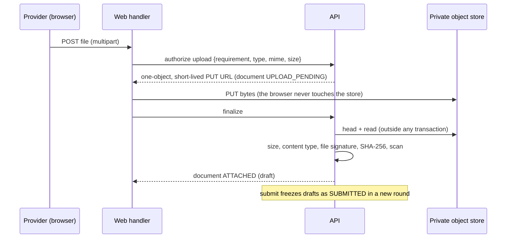

# Provider verification (TRUST-001)

How a provider is verified, and how that stays separate from everything else a provider is. Owner: the `trust` schema and `@bananagig/trust`. Decisions: [ADR-0043](../architecture/ADR-0043-provider-verification-is-a-case-of-policy-derived-requirements-not-a-verified-flag.md), [ADR-0044](../architecture/ADR-0044-verification-evidence-lives-in-private-object-storage-with-server-verified-immutable-metadata.md), [ADR-0045](../architecture/ADR-0045-scanning-and-external-verification-are-provider-neutral-ports-that-fail-closed.md). PRD: SV-09.01 (verification configurable by category and market, with expiry), SV-09.02 (sensitive documents access-controlled and audited), PR-02.03 (each check shows its state and reason; a rejected check can be fixed and resubmitted), PR-02.06 (identity verification approved before a provider is bookable), AD-02 (trust staff inspect evidence, choose an authorized action, record the reason).

## The principle: there is no `verified` flag

A provider can be asked for several different proofs (identity, background check, licence, insurance, certification ...), each decided on its own, each able to expire. So the state is a **case** made of **requirements**, and "verified" is **derived**:

| Concept | Where | Answers |
| --- | --- | --- |
| Requirement **definition** | `trust.requirement_definitions` | What can be asked (stable code, type, how it is evidenced, whether approvals expire) |
| Requirement **rule** | `trust.requirement_rules` | Where it applies (a market and/or a service type; `NULL` = all) |
| Requirement **instance** | `trust.case_requirements` | What THIS provider has to prove, one **cycle** at a time |
| **Case** | `trust.verification_cases` | The provider's verification as a whole (one live case per account) |
| **Evidence** | `trust.documents`, `trust.external_verifications` | What the provider submitted |
| **Decision** | `trust.reviews` | What a reviewer (or the external provider) decided, with a structured reason |

Verification is **not** the provider registration (PRO-001 owns onboarding), **not** the PROVIDER role (identity) and **not** Go-Live (PRO-003, which will consume the signals this domain emits). The overview always reports `goLive: { evaluated: false, eligible: false }`, and "complete" means every required requirement is approved and none has expired.

## Policy: what is asked, and where

A requirement is asked of a provider when its definition is `ACTIVE` and at least one **enabled** rule matches the provider's registration (market equals the rule's or the rule has none; the rule's service type is among the registration's or the rule has none). Nothing is hardcoded:

- Seeded: `identity_verification` is ACTIVE with one rule for every market and service type, because PR-02.06 makes approved identity verification a condition of being bookable for every provider.
- Seeded but **off and with no rule**: `background_check` (external), `professional_license`, `liability_insurance`. They demonstrate the model; no market-, category- or state-specific obligation is invented. A `trust-admin` turns a requirement on where policy says so (`PUT /api/v1/admin/trust/requirement-definitions/:code/status`, `PUT /api/v1/admin/trust/requirement-rules`), audited.
- The CAT-002 template requirement hooks (`catalog.gig_template_requirements`) describe what a Gig built from a template needs; they map onto the service-type rules when the Gig builder (CAT-003) exists. Nothing in 0015 to 0018 was changed.
- A case adopts a policy change the next time it is evaluated (opening, resuming or submitting): missing requirements are added, requirements policy no longer asks for are marked `NOT_REQUIRED` (an approval stays as history). The overview reports the difference without writing (`missing[]`).

## Lifecycles

Requirement instance: `NOT_STARTED -> PENDING (evidence submitted, round + 1) -> IN_REVIEW -> APPROVED | REJECTED | ACTION_REQUIRED`; `REJECTED` and `ACTION_REQUIRED` return to `PENDING` with new evidence (PR-02.03); `APPROVED -> EXPIRED` when its end passes; `NOT_REQUIRED <-> NOT_STARTED` follows policy. An expired requirement is re-verified by a **new cycle** (`cycle + 1`): the expired instance, its approval, its documents and its reviews stay as history. A **round** counts the provider's evidence submissions inside a cycle, and every review and document names its round, so a decision on evidence the provider has since replaced is refused (`STALE_ROUND`), and a second decision on the same evidence is refused (`ALREADY_DECIDED`; the same decision again is a no-op).

Case: `OPEN` (never submitted), `IN_REVIEW`, `ACTION_REQUIRED` (the provider owes something), `APPROVED`, `EXPIRED`, `CANCELLED` (withdrawn by the provider; refused while the case holds an approval, which would otherwise be orphaned). There is deliberately no REJECTED case: rejection belongs to a requirement and the provider may resubmit. The case status is **derived** from the instances (`deriveStatus`) and stored for the reviewers' queue; the service re-derives it in the same transaction as every change, and the database only guards its initial and terminal states.

Expiry is **derivable**: an `APPROVED` instance whose `expires_at` has passed reads `EXPIRED` immediately, whether or not the sweep (`recordExpiries`) has recorded it, and the stored case status is derived from the same effective statuses. An expired approval of a requirement policy no longer asks for is superseded the next time the case is evaluated, so it cannot keep the case EXPIRED. The sweep writes the `EXPIRED` status, the audit row and the event; scheduling it as a worker job is DEBT-0088. Approvals carry an end date taken by the reviewer from the evidence (required when the definition says `expiry_required`); there is no global validity period.

## Evidence: documents in private storage

- The bytes never enter PostgreSQL. The object key is server-generated (`trust/evidence/<case>/<document>`), unguessable, carries no account, name or content, and is **never** returned, logged, audited or put in an event. The provider uploads to a SEPARATE key (`trust/upload/<case>/<document>`): the presigned PUT stays valid until it expires, so finalize reads the upload object once, hashes and scans exactly those bytes, **copies them to the final key only while the upload object still has the version that was read**, re-reads and re-hashes what landed, and stops reading the upload key (which is deleted). A replayed PUT can only write an object nothing reads. The bucket is private; no public URL exists. Only presigned URLs for ONE object exist: the upload URL (provider, `trust.document.upload_url_ttl_seconds`) and the download URL (a reviewer with `trust-review`, `trust.document.download_url_ttl_seconds`, served as an attachment).
- The **client's metadata is never trusted**. At finalize the server checks: the object exists, its size equals the authorized size, its content type equals the authorized one, its first bytes are the **file signature** of that type (so HTML cannot pass as a PDF), the **SHA-256 it computes from the stored bytes** equals the client's when the client sent one, and the scanner's verdict. Any mismatch (including a changed object) abandons the document and deletes the objects; an infected file does the same. An authorization that is never finalized is closed (and its objects deleted) the next time the provider asks for an upload. The hash is stored for the reviewers' integrity checks and is never shown to the provider.
- **Scanning** is a port (`EvidenceScanner`). The development scanner (`TRUST_SCANNER=fake`) marks a file clean unless it contains the harmless EICAR test string; production defaults to `disabled`, which reports an error, so with `trust.verification.require_clean_scan` true (the default) **no document can be attached in production until a real scanner exists** (fail closed, DEBT-0087). A document that is not clean cannot be attached, submitted, reviewed or downloaded.
- Policy (configuration, never code): `trust.document.max_size_bytes`, `trust.document.allowed_mime_types`, `trust.document.max_per_requirement`, `trust.document.upload_url_ttl_seconds`, `trust.document.download_url_ttl_seconds`, `trust.verification.require_clean_scan`. All are engineering assumptions (DEBT-0087).
- **History is immutable.** A submitted document is frozen (only its scan verdict may still change); a resubmission is a new document in a later round; a draft may be withdrawn (its object is deleted) but a submitted document cannot. Identical content uploaded twice is two documents: a matching hash never approves anything.
- The provider can see the **metadata** of its documents and nothing else: no download, no key, no hash. (Downloading one's own evidence is not offered; DEBT-0087.) Reviewers download only what the provider SUBMITTED, in a case that was not cancelled; a draft is not evidence yet.

## External verification (adapter boundary)

A requirement whose definition says `EXTERNAL` is verified by an external provider through `VerificationProvider` (create / status / cancel / summary). Only the adapter name, the provider's identifier and a status snapshot are stored (`trust.external_verifications`); no vendor payload, no personal attribute. A relayed decision is recorded as a review by `external:<adapter>`; only the server's pull through the adapter can say so (the caller cannot), and staff can approve an externally evidenced requirement only after the provider reported it approved (to complete an end date, say), never invent the approval. An end date the provider reports is used only while it is in the future and within the bound; otherwise staff complete it. The only adapters are a development fake and a disabled one; **no ID.me or other vendor adapter exists** and none is simulated in production (DEBT-0087).

## API

Provider (owner-only, `/api/v1/provider/verification`, no identifier of an account, case, requirement or decision is ever accepted, every response `no-store`): `GET` overview, `POST` open/resume (201/200), `GET /documents`, `POST /documents/upload`, `POST /documents/:id/finalize`, `POST /documents/:id/withdraw`, `POST /submit`, `POST /cancel`, `POST /requirements/:code/reverify`, `POST /requirements/:code/external`, `POST /requirements/:code/external/refresh`. Someone else's document is `404`, indistinguishable from a missing one.

Staff (`/api/v1/admin/trust`, admin identities with client roles on `bananagig-admin`): `trust-read` (cases, metadata), `trust-review` (decisions and evidence links; implies read), `trust-admin` (policy only: no evidence, no decisions). A provider token is `403`.

| Route | Role |
| --- | --- |
| `GET /cases`, `GET /cases/:id` | trust-read |
| `GET /documents/:id/download` | trust-review (audited before the link exists) |
| `POST /requirements/:id/start-review`, `/approve`, `/reject`, `/request-action` | trust-review |
| `GET /policy`, `PUT /requirement-definitions/:code/status`, `PUT /requirement-rules` | trust-admin |

Errors are `TRUST_<code>` with an allow-listed `details`; messages are content keys (`trust.verification.error.*`). Reviewers see the internal account id only: no name, email, phone or profile.

## Audit and events

Immutable `trust.audit_events` (identifiers, codes, statuses and counts only: never content, a key, a hash, a link, a vendor payload or personal data) and outbox events in the **same transaction** as the change: `bananagig.trust.verification-case-opened | submitted | requirement-approved | requirement-rejected | action-required | expired | completed.v1`. `completed` is a SIGNAL for the later Go-Live decision; it changes no role. A no-op writes neither.

## PRO-001 integration

PRO-001's `VERIFICATION` onboarding step is answered by this domain through `PrerequisitePort` (`NOT_REQUIRED / NOT_STARTED / IN_PROGRESS / BLOCKED / COMPLETE`; a failure reports `NOT_AVAILABLE`). PRO-001 owns no verification state, does not change its own lifecycle because of it, and its submit does not require verification.

## Concurrency and locking

Provider operations lock the account row first (the ID-001 order), then the case, then the requirement rows; reviewer and system operations lock the case first. Object-store and scanner I/O never happens inside a transaction. Retries are safe: open, finalize, withdraw, submit, cancel and every decision are idempotent and write no second audit row or event. The guards (`trust_rule:<KEY>`) make the invariants true for any writer.

## Retention

Evidence is sensitive and should not be kept merely because it can be. No retention period is invented here: the schema keeps history and the policy hook is recorded as DEBT-0087 until Legal confirms a schedule. No destructive job exists.

## Not here

Go-Live (PRO-003), subscriptions, payout and tax, the public profile, Gigs, service areas, availability, bookings, a production ID.me adapter, OCR, a real malware vendor, automated licence or insurance checks, appeals, a trust console, regional requirement catalogues, expiry reminders.
